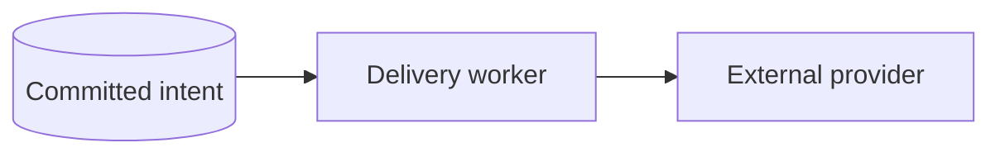

# Documentation

The website is built from Markdown and served with Go. It uses local CSS,
JavaScript, and a pinned syntax highlighter; no CDN or application backend is
required. Open http://127.0.0.1:8091 after starting the preview.

## Build and preview

Run from the repository root:

```sh
go run docs/build.go
go run docs/serve.go
```

Rebuild after Markdown, navigation, layout, CSS or JavaScript changes, then refresh.
Generated pages use content-versioned assets so browsers load the current search
index and page tools after an update. Stop the server with Ctrl+C. The server
binds to loopback, not a public interface. Static HTML also works directly from disk.

Over HTTP, internal links load articles without reloading the shared layout. Browser
Back and Forward restore the page and scroll position; section links, search results,
code tools, and Markdown downloads follow the current page. Direct URLs still work
on ordinary static hosting without rewrite rules. Opening files from disk, disabling
JavaScript, or a failed page fetch uses normal full-page navigation.

## Canonical conventions

[Project conventions](conventions.md) defines architecture, ownership, naming and
lifecycle. Source code and compiled examples define the shipped API. A guide should
explain those choices, not introduce a competing convention.

Historical files in `review/`, `plans/` and `REWRITE_PLAN.md` record earlier decisions;
they are not part of the published learning path. Do not describe a planned feature
as available or use a historical example instead of its current implementation.

## Content map and learning paths

Readers should be able to follow the documentation from their first request to a
running application, or jump directly to an operation they need.

| Category | Reader's question | Main content |
| --- | --- | --- |
| Getting started | How do I adopt, run and update this? | Installation, adoption and updates, configuration, first module, local development, setup failures |
| Architecture | Where does this code belong? | Structure, conventions, composition, registration, lifecycle, shared types, CLI, errors |
| HTTP APIs | How do I expose a use case or call another API? | Routes, handlers, requests, validation, responses, middleware and outbound HTTP clients |
| Database and state | How do I read, save and coordinate data? | Connections, queries, transactions, migrations, seeders, cache |
| Authentication | How does a user sign in and keep a session? | OTP, social sign-in, profiles, authorization, refresh and logout |
| Background work | How do I run work later or react to a change? | Tasks, workers, retries, events and recurring schedules |
| Communication | How do I send a message? | Mail views, mail, notifications and push |
| Files and media | How do I store and serve content? | Disks, assets, ownership, visibility and URLs |
| Workflows | How do the components work together? | Persisted HTTP/CLI operation, transactional notification intent, onboarding |
| Operations | How do I run and diagnose this? | Logging, observability and deployment |
| Testing | How do I verify behavior? | HTTP, modules, database transactions, tasks and events |
| Reference and extensions | What are the options and maintenance commitments? | Configuration, live API reference, support policy, security reporting, release checks, optional WebSockets |

Keep one authoritative explanation per concept. The queues guide owns task creation,
workers and failures; old queue pages lead readers to the matching section. The mail
guide owns mail views. Filesystems and media remain separate because raw storage and
managed assets have different responsibilities. Package READMEs may be the canonical
published source; do not duplicate them into a second manual under `docs/`.

Reuse a few complete workflows across guides. The Catalog starter introduces module
construction and registration. Profile updates demonstrate request mapping and
transactions. Onboarding connects events, jobs, notifications and mail. Each topic
explains its own boundary and links to the full workflow.

## Add or move a page

`navigation.json` defines category order, page titles, Markdown sources and output
slugs. Sources can live anywhere in the repository, including package READMEs:

```json
{
  "title": "Media assets",
  "slug": "media",
  "source": "internal/platform/media/README.md"
}
```

Edit source Markdown, never generated `*.html`, `markdown/*` or `search-index.js`.
The build renders those outputs and validates local links and exact heading anchors.

When consolidating content, preserve the old source, slug and important headings as
a concise linking page. Add `"hidden": true` to that page's navigation entry. It will
still build and receive a Markdown download, but is omitted from the sidebar,
Previous/Next sequence and search. Do not hide a page until its replacement covers
the material and its section links work. Do not silently delete established URLs.

Links to registered Markdown sources are rewritten to published HTML, including
relative links from package READMEs. Prefer those links when the Markdown must also
work on a source hosting site. HTML links such as
`configuration.html#understand-precedence` are supported too. Use relative paths so
the site works beneath a hosting path prefix. External links are not checked by the
builder; verify referenced external instructions separately.

## Write a practical guide

A substantial guide normally follows this progression. Adapt it to the capability;
small references do not need empty sections to satisfy a template.

1. **Purpose.** State the problem, when to use the capability, and meaningful choices.
2. **First success.** Show prerequisites, a working example and its expected outcome.
3. **Common operations.** Use task-based headings: “Delay a task” or “Return a private URL.”
4. **Configuration and integration.** Put relevant settings and module wiring beside the operation.
5. **Failures and guarantees.** Explain acceptance, persistence, retries, cancellation and transaction boundaries where they matter.
6. **Verification.** Show a useful test or diagnostic, symptoms and recovery steps.
7. **Advanced use.** Explain independent construction, extension points and native-library escape hatches.
8. **Continue.** Link to a few specific next operations or complete workflows.

Use one H1, H2 for major sections, and H3 for details. Keep headings descriptive:
“Configure retries” is easier to find than “Advanced.” Avoid manually maintaining a
second table of contents: the builder creates section outlines and heading links.
Search indexes each H2/H3 separately, including its code, page and parent-section
context. API symbols such as `response.JSON` are searchable.

Keep prose short and purposeful. Use a table for choices, snippets for operations,
and a diagram when ownership or sequence needs a picture. Keep essential limits in
view; a reader should not need the final paragraph to discover that an operation is
best-effort or cannot join a SQL transaction.

### Make examples usable

Every example should answer **where it goes**, **what it needs**, and **what happens**.

- Give a filename and full imports for a first complete file.
- Label shorter snippets as an existing function body or a focused change; identify assumed values such as `ctx`, `resources` or `userID`.
- Use a preceding label such as **File:** `internal/modules/catalog/register.go`. It remains readable in downloaded Markdown and without JavaScript.
- Show meaningful error handling and the expected response, command output or stored result.
- Fence code with `go`, `sh`, `dotenv`, `json`, `yaml`, `sql`, `http` or `text`.
- Use placeholders for credentials; never publish values from a local environment.
- Link complete runnable examples to their maintained source instead of copying many variations.
- State when manual wiring is required. Distinguish reusable `pkg` imports from application-owned `internal/platform` imports.

Similar names do not imply identical guarantees. For example, mail enqueueing and
notification enqueueing have different persistence boundaries. Explain the actual
contract beside each call, including what successful return acknowledges.

### Complete one topic before moving on

A finished guide has:

- Verified APIs, defaults, prerequisite services and lifecycle ownership.
- A first-success path plus its useful variations and failure behavior.
- Checked examples, with complete files linked to or compared against compiled code.
- Working onward links, preserved legacy URLs and no conflicting duplicate explanation.
- Usable code blocks, section navigation and search on desktop and narrow screens.

Run the relevant example and configuration checks below, then rebuild to check all
local links. Record any checks that depend on unavailable infrastructure rather than
claiming they passed.

## Visual explanations

Use a diagram when relationships, branches or boundaries are harder to follow in
prose. Use a walkthrough for an ordered process where each step has a different
responsibility or guarantee. Keep directory trees as text and comparisons as tables.
Prefer one focused visual to a diagram of the entire system; retain the surrounding
explanation and link to the deeper guide.

Fence diagrams with `mermaid`. Include `accTitle` and `accDescr` so each diagram has
a visible title, a plain-language explanation and an accessible SVG description:



Prefer top-to-bottom flows for long processes. Label arrows with what happens and
make failure paths explicit. Do not encode a guarantee solely in color. Use an
expanded view for complex diagrams; smaller screens can scroll within the figure.
The renderer uses the site's light/dark palette and runs again after SPA navigation.
Source stays available below each diagram, including when rendering fails.

A walkthrough is an ordinary Markdown blockquote with a marker, a short introduction
and an ordered list. Start each step with a bold title:

```markdown
> [!WALKTHROUGH] Follow one operation
>
> Each step introduces one boundary.
>
> 1. **Save intent.** Persist the work in the business transaction.
>
>    No external provider is called yet.
>
> 2. **Deliver later.** A worker attempts the committed work.
>
>    The handler must tolerate repeated delivery.
```

The builder preserves the full ordered explanation. JavaScript adds step selection,
Previous/Next controls and an announced position; print and no-JavaScript views show
every step. Walkthroughs reuse the article palette, typography and spacing from
`style.css`; `visuals.js` owns their shared behavior and diagram rendering.

Mermaid Tiny **11.17.2** is pinned locally in `vendor/mermaid.min.js`, with its MIT
license in `vendor/mermaid.LICENSE` and bundled third-party notices retained. It loads
only when an article contains a diagram; no browser CDN, remote fonts or rendering
service is required. This build supports the flowcharts, sequences and state diagrams
used here, but excludes mindmaps, architecture diagrams, KaTeX and ELK layout.
Rendering uses strict security mode, with diagram-provided click actions disabled.

Upstream: [Mermaid usage](https://mermaid.js.org/config/usage.html),
[accessibility](https://mermaid.js.org/config/accessibility), and
[pinned bundle](https://cdn.jsdelivr.net/npm/@mermaid-js/tiny@11.17.2/dist/mermaid.tiny.js).

After changing visuals, rebuild and check direct loads, internal navigation,
Back/Forward and anchors, light/dark themes, keyboard controls, narrow layouts,
expanded diagrams and the source fallback. Run the builder tests below too.

Before publishing, build the site, check local links and anchors, verify snippets
against their callers, and inspect desktop and narrow layouts. Search, copying,
the theme switch, and keyboard navigation should work without external requests.
Static section outlines, heading links and the sidebar must remain usable with
JavaScript disabled; search and clipboard enhancements require JavaScript.
Do not claim unrun database or broker checks passed.

## Code theme and dependencies

Code panels use the editor's Catppuccin Macchiato palette: `#24273a` background,
`#cad3f5` text, purple keywords, green strings, blue italic functions, yellow
italic types, pink italic parameters, and teal operators. Nested brackets use
its six-color cycle. Fira Code is used when installed, with monospace fallbacks.

Go snippets are highlighted at build time using the standard Go scanner and AST.
The parser recognizes complete files, declarations, and statement fragments.
This distinguishes calls, types, package qualifiers, and scoped parameters without
changing copied text. It does not run gopls or load dependencies: incomplete
snippets and unresolved external symbols cannot reproduce every editor semantic
token. Import underlines match the editor styling but are not navigation links.

Other languages use Highlight.js 11.11.1, vendored in `vendor/highlight.min.js`
with its BSD license. Unsupported languages remain plain text. The browser skips
Go blocks that were already highlighted by the builder.

CI also checks complete starter, entry-point, task and mail examples against their
compiled source files, including the transactional profile example, and fails when generated guides differ from committed output.
Run `go test ./tests/modules` after editing those examples.

The configuration reference is maintained with its owner: `go test ./internal/app/config -run TestConfigurationReferenceMatchesDefaults` checks
key coverage and defaults, including named queue priorities and filesystem overrides.
Update the reference tables alongside settings changes; do not add a second
runtime configuration schema to generate documentation.

Verify the highlighter after changes:

```sh
go test docs/build.go docs/highlight_test.go
go vet docs/build.go
go run docs/build.go
```

Vendored source: https://cdnjs.cloudflare.com/ajax/libs/highlight.js/11.11.1/highlight.min.js
License: https://github.com/highlightjs/highlight.js/blob/11.11.1/LICENSE

## Static hosting

Deploy generated `*.html`, `style.css`, `app.js`, `visuals.js`, `search-index.js`, `markdown/`,
and `vendor/` together, preserving relative paths. No version selector or server
rendering is required. Build tools and source Markdown do not need to be public.
Keep legacy landing pages alongside current guides when content is consolidated.
The site needs no redirects or server rewrite rules to preserve those URLs.
