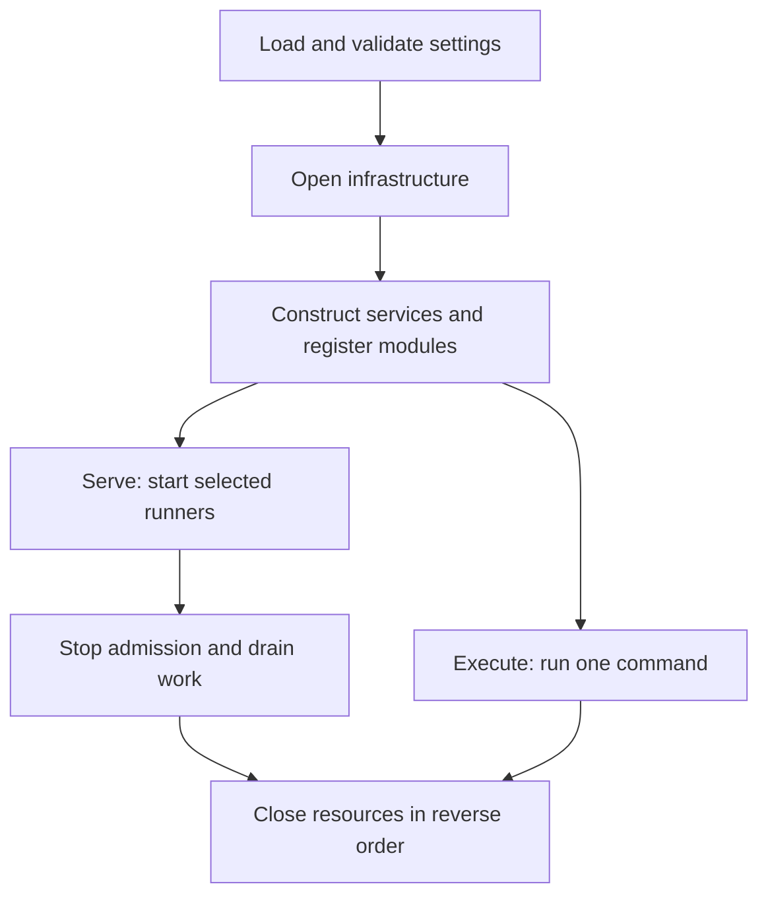

# Application lifecycle

Use `app.Serve` for long-running services and `app.Execute` for console commands.
Both construct the application once and own its resources until execution finishes.



## Supply settings and select processes

Serve owns the complete invocation. The entry point supplies typed configuration,
signals and exit handling:

```go
package startup

import (
	"context"
	"github.com/wisalgroup/labena/internal/app"
	"github.com/wisalgroup/labena/internal/app/config"
)

func Run(ctx context.Context, cfg config.Config) error {
	return app.Serve(ctx, cfg, app.Processes{
		HTTP: true, Workers: true,
	})
}
```

Use `config.Load()` for environment settings or `config.Defaults()` as a baseline
for programmatic settings. Treat settings collections as immutable during Serve.
`app.Execute(ctx, cfg, processes, args)` owns a console invocation. Its caller
loads settings just as for Serve; processes applies only to the serve command.
The application instance is private; callers never coordinate Run and Close.

## What construction does

App validates configuration, opens configured resources,
then constructs authentication and registers module handlers, commands and SQL before
installing the centrally declared schedules. Module Register
functions construct their local repositories and services without I/O. The
finished console tree and SQL history are validated before execution.

Resource acquisition can contact configured infrastructure. Construction starts
no listeners, task consumers or recurring jobs and applies no DDL. Opened clients
may own background work, such as the tracing exporter's batch worker; app registers
their cleanup as soon as acquisition succeeds. Failed construction closes everything
acquired so far. Modules never acquire or close shared resources.

## Startup and readiness

Serving validates installed-module dependencies and the selected processes and prepares registered event subscriptions before admitting producers. It starts selected services concurrently and waits for their readiness signals when available.
```sh
curl -i http://localhost:8080/healthz
curl -i http://localhost:8080/readyz
```

| Endpoint | Meaning |
| --- | --- |
| `/healthz` | The HTTP listener can respond |
| `/readyz` | Selected services have passed startup readiness and shutdown has not begun |

These endpoints are defined in `internal/platform/api/health.go` and registered on
the application server. The app owns their readiness and stopping signals.

Readiness returns 503 during startup and shutdown, and 200 after startup succeeds. By default it is not continuous database or broker monitoring. With
`HTTP_READINESS_DEPENDENCIES=true`, each ready probe checks the configured database,
queue Redis and rate-limit Redis within `HTTP_READINESS_TIMEOUT` (default `1s`).
Checks run sequentially under one deadline and at most one probe runs at a time;
concurrent probes return 503. A failed check returns 503 `unavailable`, and the next
successful probe restores 200. Cache, mail and telemetry are excluded. Ping checks
establish connectivity, not schema compatibility or permission for every operation. Every app runner supplies a readiness signal.

An unexpected service exit, including a nil return before cancellation, fails the run and initiates shutdown of its siblings. A panic in a runner is reported as an error.

## Shutdown order

On cancellation or service failure, the app marks readiness unavailable and drains these groups in order:

> [!WALKTHROUGH] Follow an orderly shutdown
>
> The next group stays available until the previous group finishes. Step through
> the sequence to see which dependencies still have users.
>
> 1. **Stop admission.** Mark readiness unavailable. Stop HTTP, the scheduler and
>    the notification dispatcher, and finish their admitted work.
>
>    Queue workers and local event subscribers are still available.
>
> 2. **Drain workers.** Stop taking new tasks and finish or cancel active handlers.
>
>    Keep local subscribers and shared clients alive while handlers use them.
>    Pending Redis tasks remain for a later worker.
>
> 3. **Drain subscribers.** Once the producers have stopped, finish admitted event
>    handlers and join their work.
>
>    The app does not close clients underneath a running handler.
>
> 4. **Stop metrics.** Keep scraping available through the business-service drain,
>    then stop the metrics listener.
>
>    Shutdown groups share one drain budget.
>
> 5. **Release resources.** Close owned resources in reverse construction order.
>
>    Cleanup has its own budget. If drain times out with handlers still running,
>    resources they use stay open and the executable reports failure.

Every service in a group receives cancellation before the app waits for that group to finish. The next group remains available until the previous group finishes.

This drains active work, not the entire backlog. Durable pending messages remain for a later worker. Separate processes require deployment-level coordination; one app can only order its own services.

Normal cancellation returns nil after a successful drain. Other failures remain errors.

## Set time budgets
```dotenv
APP_STARTUP_TIMEOUT=30s
APP_SHUTDOWN_TIMEOUT=45s
APP_CLEANUP_TIMEOUT=10s
```

Construction and runner startup each use the startup setting. Shutdown has one budget shared across its ordered groups. Resource cleanup has a separate budget. Driver and HTTP-specific timeouts still apply; allow enough deployment termination time for both drain and cleanup.

Cancellation is cooperative. Handlers, runners, and cleanup functions must observe their contexts and return. A timeout does not forcibly stop a goroutine.

If drain times out, app cancels all remaining runners and returns
`app.ErrShutdownTimeout`. Resources still used by handlers stay open; the supplied
executables report failure and exit. A timeout cannot forcibly stop a goroutine.
Cleanup errors are preserved alongside startup or runtime failures.

Modules borrow dependencies. HTTP shutdown also closes upgraded connections,
including WebSockets. Keep session work inside its handler so shutdown can join it;
protocol close messages remain the module's responsibility.

## Bootstrap phases and extension points

The startup diagram above maps to a few explicit files. There is no hidden
container or discovery phase between construction and execution.

One private `application` holds configuration, resources, targets, native runners
and the selected process list. `open.go` shows initialization and failure cleanup;
`infrastructure.go` acquires resources and immediately records cleanup with the
application's lifecycle owner. `auth.go` constructs authentication before protected targets. `modules.go`
lists registration calls. Each module constructs its local services from borrowed
`dependencies.Resources` and receives preconstructed business collaborators as
explicit arguments. It registers through `dependencies.Targets`. App owns resources;
modules borrow them.
No runtime container lookup or automatic discovery is involved.

| To add or change | Go to |
| --- | --- |
| Infrastructure settings and defaults | `config/<capability>.go` |
| Infrastructure construction, global middleware and cleanup | `app/infrastructure.go`, in acquisition order under `openInfrastructure` |
| Business dependencies and module registration | `app/modules.go` and the module's `Register` function |
| HTTP, task, event or command handlers | The owning module's delivery packages |
| Recurring tasks or commands | `internal/app/schedules.go` |
| Process services, readiness prerequisites and shutdown phases | `app/processes.go` |

`configureProcesses` fills the application's process list without starting work.
The application's `run` method validates serving requirements and passes that list
to its lifecycle owner. HTTP and scheduled admission stop before
workers, subscribers and metrics; borrowed resources close only after their users
finish. Single CLI commands share the same app ownership boundary but do not start
service runners. Native clients and middleware remain available at these explicit
integration points.

### Command startup boundaries

Every CLI command, including help and completion, constructs the application first.
All configuration and registered migration sources must be valid. Resources checked
during acquisition must be reachable; lazy clients may report connectivity errors
only on first use. Queue Redis is lazy, SMTP connects when sending, and opening a
remote storage client does not prove its bucket is reachable. There are no separate
offline command declarations or application invocation callbacks. Handlers borrow
already constructed services.
App closes resources when execution returns, including errors and panics.
Migrations execute only on explicit selection and use their own dedicated database
session for the Goose lock/refresh contract. Queue administration shares app's
queue Redis pool.

`cmd/app` and `cli serve` explicitly select HTTP and workers. HTTP and workers
include local event consumers automatically. `cmd/worker` selects workers and
`cmd/scheduler` selects scheduling. Run one scheduler per schedule set.
Production deployments must set `APP_ENV=production`.

The messaging runner explicitly closes Watermill and joins admitted calls, including
after a native shutdown timeout or partial subscription failure. An empty subscription
set starts no native delivery loop. Serve and `cli serve` enforce the same installed-module
DB requirement; route-only construction without a DB is not a serving application.

## Diagnose a lifecycle failure

| Observation | Meaning and next step |
| --- | --- |
| Construction fails | No application runners started; check the named dependency or invalid registration |
| HTTP is not admitting traffic | It waits for selected worker/subscriber startup; check their readiness |
| `/readyz` becomes 503 | Startup/shutdown state or an enabled dependency probe failed |
| One runner exits unexpectedly | App treats it as failure and drains its siblings |
| Shutdown returns `ErrShutdownTimeout` | A consumer exceeded the shared drain budget; inspect blocked work and context handling |
| Cleanup also fails | The returned error preserves cleanup alongside the original failure |

Use [observability](observability.html) for correlated logs and traces, and
[deployment](deployment.html) to align termination grace periods with these budgets.
