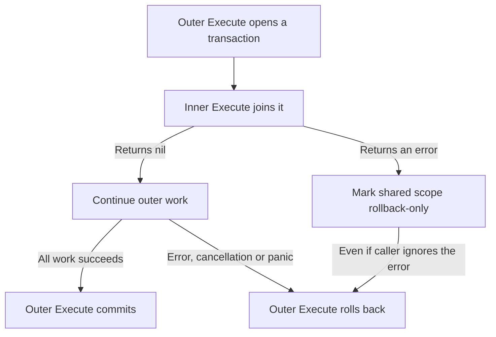

# Transactions

Use a transaction when several database changes must succeed together. App assembly supplies `Resources.Transactions`, backed by the same Bun pool as `Resources.DB`.

For a single independent write, the database statement may already provide the
atomicity you need. Add an explicit transaction when several writes or a
read-modify-write invariant must share a commit boundary.

| Work | Can join the SQL transaction? |
| --- | --- |
| Repositories using `database.Executor` and the same pool | Yes |
| Database cache with the same pool | Yes |
| Notification `Enqueue` using the same pool | Yes; it persists delivery intent |
| Redis cache, raw queue submission, local event publication | No |
| Mail delivery, push delivery, blob storage | No |

## Execute an atomic operation

Accept the existing `*database.TxManager` from construction. Repositories use the
executor carried by the callback context and share its database pool. Business
services do not import the dependency bundle or redeclare the transaction contract.

Inside an operation with the borrowed transaction manager:

```go
return s.transactions.Execute(ctx, func(ctx context.Context) error {
    if err := s.products.Create(ctx, product); err != nil {
        return err
    }
    return s.audit.Record(ctx, product.ID)
})
```

This is a workflow fragment: `s.products` and `s.audit` are service dependencies you implement. Both must use `database.Executor(ctx, db)` with the same database. Audit in this example means a database write, not an external logging or network operation.

Returning nil commits the outer transaction. Returning an error or cancellation rolls it back. Panics also trigger rollback and are rethrown. Do not commit or roll back manually inside `Execute`; it owns completion.

## Resolve the transaction in repositories

```go
executor, err := database.Executor(ctx, r.db)
if err != nil {
    return err
}
_, err = executor.NewInsert().Model(product).Exec(ctx)
return err
```

Without a transaction, the executor is the pool. Within a scope, it is the active Bun transaction. Passing the original parent context instead of the callback context loses that scope. Using the raw pool bypasses it too; the package cannot intercept those calls.

A context containing a transaction for another database is rejected with `database.ErrDifferentDatabase`. Keep the transaction manager and repository pool paired.

## Nested calls join the transaction



An inner `Execute` joins the existing scope. It does not commit independently or create a savepoint. If an inner operation fails, the outer scope becomes rollback-only even when a caller ignores the error.

```go
err := transactions.Execute(ctx, func(ctx context.Context) error {
    _ = transactions.Execute(ctx, func(context.Context) error {
        return errors.New("required write failed")
    })
    return nil
})
// err remains non-nil: the outer transaction cannot commit.
```

Use ordinary error propagation in application code; the ignored error above only demonstrates the protection. Transaction contexts must not escape their scope or be used concurrently by goroutines. The manager itself can be shared across requests.

## Configure isolation

When a workflow needs explicit transaction options, construct a manager with the same pool:

```go
transactions, err := database.NewTxManager(db, &sql.TxOptions{
    Isolation: sql.LevelSerializable,
})
```

Import `database/sql`. Handle the constructor error and inject the manager into the relevant service. Options are copied. Nil options inherit an active scope; explicit nested options must match the outer options or the call fails.

Choose isolation for the operation's invariants and supported backend. Serialization or deadlock failures may require retrying a whole operation, but the package does not retry automatically. First establish which errors and effects are safe to repeat.

## Use a savepoint for recoverable child work

`Savepoint` is available on the same `*database.TxManager` supplied by app assembly. It requires an active transaction:

```go
err := manager.Execute(ctx, func(ctx context.Context) error {
    childErr := manager.Savepoint(ctx, func(ctx context.Context) error {
        return optionalWrite(ctx)
    })
    if childErr != nil {
        return childErr
    }
    return requiredWrite(ctx)
})
```

Here `optionalWrite` and `requiredWrite` are functions supplied by the workflow. To continue after a child error, inspect it and deliberately handle an expected failure. Savepoint errors undo child writes; successful child writes still depend on the outer commit. Cleanup failure marks the parent rollback-only. A child panic is rolled back and rethrown.

Ordinary service workflows usually need only `Execute`. Do not replace it with savepoints just to avoid returning errors.

## Couple writes with publication

Redis tasks and GoChannel events do not join Bun transactions. A commit followed
by publication can fail between those actions; publishing inside the transaction
can expose work before a rollback. Neither sequence makes both actions atomic.

`Notifier.Enqueue` persists channel intent in the caller's SQL transaction.
Its [delivery ledger](notifications.html) supplies a focused outbox for notifications.
Other durable publications need their own deliberate outbox or compatible publisher.
Keep remote effects outside retryable transactions and tolerate duplicate delivery.
`database.RequireNoTransaction` guards Mailer sends/enqueues, immediate notification
delivery/dispatch, media mutation, framework Publisher calls and app queue enqueue
calls. These reject transaction-scoped or already canceled contexts before effects.
Standalone Asynq clients can opt into `middleware.RequireNoTransaction()` as the
outermost client middleware; raw native clients bypass this policy. The guard
does not make publication after commit atomic.

For a complete compiled transaction workflow, see
[Profile update with notification intent](transactional-notifications.html) and
`examples/module/profile/update.go`.

> [!WALKTHROUGH] Keep a write and its notification together
>
> Use this sequence when the notification intent must survive with the business
> change. The notification ledger is the boundary between SQL and external work.
>
> 1. **Begin one scope.** Execute supplies a transaction-bearing callback context.
>    Pass that same context to each participating repository and to Enqueue.
>
>    All participants must use the same database pool.
>
> 2. **Write both records.** Save the business change and the notification intent
>    through the transaction's executor.
>
>    Do not send mail or enqueue a raw Redis task inside this scope.
>
> 3. **Commit or roll back.** If the operation returns nil, the outer Execute
>    attempts commit. An operation error rolls back both sets of writes.
>
>    A commit error can have an uncertain outcome; do not blindly rerun the callback.
>
> 4. **Deliver after commit.** The dispatcher sees committed notification intent
>    and queues it for channel workers.
>
>    External delivery is retryable work. Consumers still need duplicate tolerance.

## Deadlines and uncertain commits

Use a bounded operation context and keep transactions short. A failed commit may have an uncertain outcome; do not automatically rerun the callback. Preserve errors for diagnosis while keeping sensitive driver details out of responses.

`Begin`, `Commit`, and `Rollback` are available for explicit ownership, but require careful cleanup on every exit path. Prefer `Execute` for business operations. `TxFromContext` exposes the native transaction to adapters without transferring commit ownership.

## Preserve owned security transactions

Identity's failed-proof counters and refresh-token reuse revocation can need to
commit even when authentication is denied. Those operations deliberately own their
security transactions. Do not wrap them mechanically in an outer transaction that
rolls back on every returned authentication error. See [Identity](identity.html)
for the operation's behavior before composing it into another workflow.

## Verify the commit boundary

Use database integration tests for the invariants that matter:

| Scenario | Expected result |
| --- | --- |
| Two writes, callback succeeds | Both persist |
| Second write fails | Neither persists |
| Nested Execute fails and caller ignores it | Outer transaction still rolls back |
| Repository uses another pool | `ErrDifferentDatabase`; no cross-pool atomicity |
| Remote effect attempted with transaction context | Framework guard rejects it before the effect |
| Savepoint child fails and expected error is handled | Child writes are undone; parent can continue |

The disposable PostgreSQL tests in `pkg/database` cover manager behavior. Business
workflow coverage belongs in `tests/<module>` and should observe persisted state,
not merely that callbacks were invoked. Continue with
[transactional notifications](transactional-notifications.html) and
[database testing](testing-database.md).
