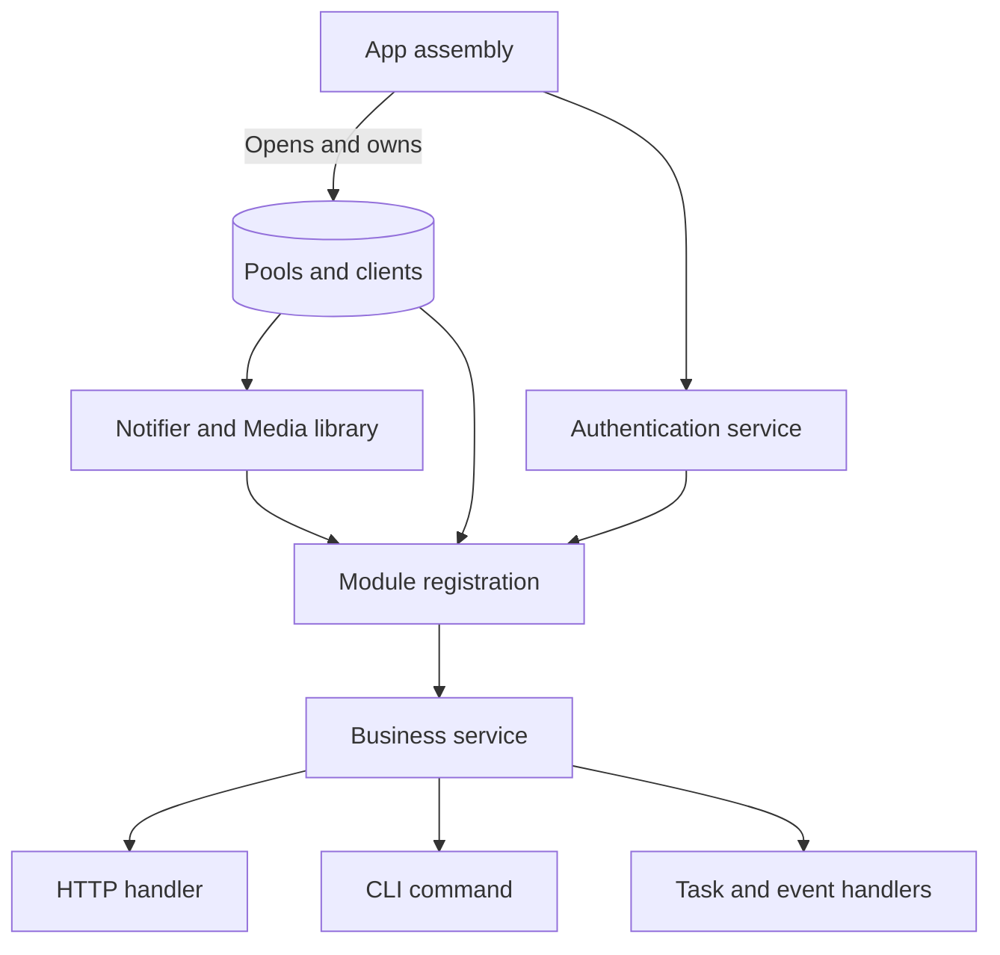

# Dependency injection

Pass dependencies through ordinary Go constructors. App creates shared clients;
module assembly selects the clients its services need. A handler receives its
operation directly, so it never needs to discover or construct dependencies.

## Construction and ownership



Two assembly structs have different purposes:

| Struct | Contains | Used by |
| --- | --- | --- |
| `dependencies.Resources` | Existing clients, pools and shared capabilities | Module Register functions and app assembly |
| `dependencies.Targets` | Routers and registration destinations | Module `Register` functions |

Copying Resources shares the clients; it does not clone connections. Modules never
mutate its maps or close borrowed clients. Services and handlers receive specific
fields rather than retaining the complete bundle.

App keeps both bundles on one private `application`, alongside configuration,
the lifecycle owner and process handles. Native registries live directly in
`application.targets`; the worker and module handlers use the same instances.
The private application is never passed into modules or platform capabilities.

## Construct a service explicitly

Identity assembles its profile operations with ordinary constructors:

```go
repo := repository.NewUserRepository(resources.DB)
users, err := service.NewUserService(repo)
if err != nil {
    return err
}
```

This **module-registration fragment** imports
`github.com/wisalgroup/labena/internal/modules/identity/repository` and `github.com/wisalgroup/labena/internal/modules/identity/service`.
`resources` is the borrowed `dependencies.Resources` argument. No query runs here.

The same `users` value is passed to HTTP registration and `modulecli.New(users)`.
They call the same rules; only their input/output adaptation differs. Follow the
[persisted HTTP and CLI workflow](persistent-workflow.html) to see both callers.

## Service and repository contracts

The required layout keeps public contracts in the owner's package and entity
implementations in plural-named files:

```text
identity/service/
  service.go      UserService and AuthService interfaces
  users.go        userService and NewUserService
  auth.go         authService and NewAuthService
  refresh.go      Example large use case on *authService

identity/repository/
  repository.go   Focused repository interfaces
  users.go        userRepository and NewUserRepository
  sessions.go     sessionRepository and NewSessionRepository
```

Each implementation type is private; exported `New<Subject>Service` and
`New<Subject>Repository` constructors return the owner interface, optionally with an
error when validation can fail. A larger service use case can live in another file
on the same receiver. File organization does not require another abstraction,
service instance or constructor. Follow the mandatory
[contract and filename rules](conventions.html#mandatory-module-contract-and-implementation-layout).

Multiple consumers import the same owner contract. Avoid duplicating
`UserService`, `mail.Sender` or `messaging.Publisher` in each caller just to change
the package name. Add interfaces where substitution or a stable business API is
useful; concrete capabilities such as `*notification.Notifier` and `*media.Library`
are intentional too.

## Required arguments and options

Use explicit arguments for a small required dependency set. Use a cohesive options
struct when construction has several collaborators or optional controls:

```go
notifier, err := notification.New(db, notification.Options{
    Queue:     queue,
    Mailer:    mailer,
    MailRenderer: views,
})
if err != nil {
    return err
}
```

This **construction fragment** assumes already constructed clients and imports
`github.com/wisalgroup/labena/internal/platform/notification`. The caller retains the resulting
notifier for its operations; constructing it sends nothing.

`Config` describes settings; `Options` describes constructor controls and
collaborators. A business service must not import app or read environment variables
to complete its construction.

## Cross-module calls and transactions

Pass a business service from one module to another as an explicit assembly
argument. Keep business services out of Resources. App may construct services needed
before registration using owner constructors; transport handlers never construct repositories.

Use a direct call when the current operation requires a result. Use an event for
an independent reaction with an accepted delivery guarantee. The local event bus
does not make a required operation reliable across a process crash.

| Interaction | Ownership boundary |
| --- | --- |
| Read/update an account | Call Identity's service and apply caller authorization |
| Store notification intent with a business change | Use `Notifier.Enqueue` inside the same database transaction |
| Send email or write an object | External effect; cannot roll back with SQL |
| Publish a local event after commit | Commit remains valid if publication fails |

DB and Transactions must use the same pool. Repositories resolve their executor
from context to join the transaction. Normal service operations own transaction
scope; Identity's security operations have explicit exceptions for durable failed
proof counters and refresh-reuse revocation. See
[transactions](database-transactions.html).

## Context carries scope, not dependencies

Propagate the caller's context to every operation. It carries cancellation,
deadlines, transaction scope and logging/trace metadata. Inject clients through
arguments instead of retrieving them from context or a global container.

Handlers must finish their work before returning. Put deferred processing on the
queue instead of spawning an unowned goroutine that outlives the handler.

## Optional capabilities

| Resource | Disabled behavior |
| --- | --- |
| Cache, Pusher, RateLimiter | May be nil when their feature is disabled |
| Disks | Only selected disks are opened; disabled storage has no usable disk |
| TracerProvider, MeterProvider | App supplies providers; disabled telemetry is no-op |
| Mailer | Always constructed; SMTP connects on sending |
| DB/Transactions | Can be absent for limited assembly; installed modules cannot serve without them |

Validate the dependencies required by an enabled operation during construction.
Do not defer an inevitable nil dereference until a request. A nil registration
target omits a transport; it does not grant access or change a service policy.

## Use a capability independently

Within this application template, instantiate a platform capability from its
actual clients and options without importing app or Resources. Its integration
package is needed only when registering framework transports.

For reuse from another Go module, choose a `pkg` capability: Go's `internal` import
rule deliberately limits platform packages. See the [package index](structure.html#package-index).

## Optional push

`Resources.Pusher` is the optional `push.Sender`; it is nil when disabled. App also
passes it to Notifier for durable channel delivery. Choose [direct push](push.html)
for an immediate provider call or [notifications](notifications.html) for persisted
recipient delivery. Inject the selected collaborator into your service.

## Account and authentication operations

Identity separates profile operations (`UserService`) from proof/token/session
operations (`AuthService`). Both expose owner contracts with private implementations.
`SignInResult` carries the committed user, tokens and Created flag; HTTP maps the
flag to 201/200. See [Identity](identity.html) for account policy and its security
transaction exceptions.

## Verify wiring

Use narrow fakes for service decisions and real disposable backends for SQL,
Redis, retries and ownership isolation. App tests call public `Serve`/`Execute`;
module tests can supply only the targets they need. Keep business tests under
`tests/<module>`.

Continue with [module registration](module-registration.html),
[shared types](shared-types.html), or [lifecycle](application-lifecycle.html).
