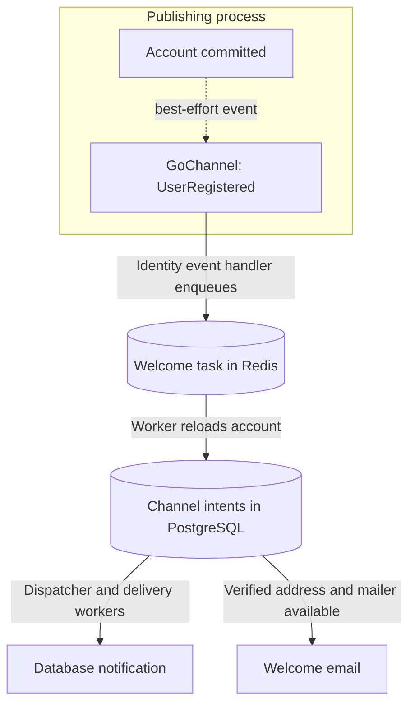

# Events and pub/sub

An event announces a fact that already happened. Other modules can react without
the publisher knowing their implementations. This application uses **Watermill
GoChannel only**: a process-local, in-memory pub/sub bus.

## Signup flow



Account creation completes before publication. Identity owns the welcome content
and subscribes through `identity/register.go`. Signing in to an existing account publishes no registration event.

These reactions are **best-effort**. A successful publish does not mean a subscriber
completed its work. Events can be lost when no subscriber is running, during a
restart, or after a process failure. GoChannel does not replay missed events and
cannot communicate between API and worker processes or between replicas.

## Terms and ownership

| Term | Meaning here |
| --- | --- |
| Event | A fact, such as a user being registered |
| Topic | The string used to route that event |
| Publisher | Sends an occurrence to a topic |
| Subscriber | Receives occurrences in the same process |
| Handler name | Unique router identity used for registration and diagnostics |
| Payload | The typed data encoded as JSON |

Published business event definitions and common occurrence metadata live in
`internal/modules/shared/events`. Identity owns the meaning and version of `UserRegistered`;
handlers belong to consuming modules in `delivery/events`. App assembly owns the
bus, middleware, router startup and shutdown; modules borrow the publisher and
registration targets.
Handler names are not durable consumer groups or broker queues.

`events.Event` exposes `ID`, `Type` and `OccurredAt`, serialized as `event_id`, `event_type`
and `occurred_at`. It has no embedded interface, event buffer or dispatch hooks.
`UserRegistered` embeds this metadata and adds `user_id`; its topic remains
`identity.user_registered.v1`.

Keep this package small: payload structs, topic constants, occurrence metadata and
`New…` constructors. Use IDs and event-specific values, without importing business
entities, services, repositories, platform capabilities, config or transport types.
Constructors describe occurrences; they do not publish or register handlers.
Producers own schema compatibility and introduce a new topic version for an
incompatible contract. Consumers can learn the contract without importing the
producer's implementation.

## Publish an event

Publish after a successful operation, outside a database transaction. Here `events`
is `github.com/wisalgroup/labena/internal/modules/shared/events`:

```go
event := events.NewUserRegistered(user.ID)
if err := publisher.PublishWithID(ctx, events.UserRegisteredType, event.ID.String(), event); err != nil {
    // The business commit already succeeded. Report this optional reaction failure.
    logging.FromContext(ctx).ErrorContext(ctx, "registration event publication failed")
}
```

This fragment assumes an already committed `user`, the caller's `ctx` and a borrowed
`messaging.Publisher`. It imports `github.com/wisalgroup/labena/pkg/logging` for the safe failure log.
Do not log the whole event or return an error that implies the committed account was
rolled back. Required follow-up work needs a persisted intent, not this local event.

Identity performs this for OTP signup and first social login. It logs publication
failure without returning a signup error:
the account is already committed, so retrying signup would be misleading.
Repositories perform persistence only; they do not publish events.

## Define an event contract

**File:** `internal/modules/shared/events/user_registered.go` (the existing contract):

```go
package events

import "github.com/google/uuid"

// UserRegisteredType is the topic for Identity account creation.
const UserRegisteredType = "identity.user_registered.v1"

// UserRegistered records an account created by Identity after its transaction
// commits. Consuming modules own their reactions.
type UserRegistered struct {
	Event
	UserID uuid.UUID `json:"user_id"`
}

func NewUserRegistered(userID uuid.UUID) UserRegistered {
	return UserRegistered{Event: NewEvent(UserRegisteredType), UserID: userID}
}
```

`NewEvent` supplies a fresh UUID and UTC occurrence time. Creating this value has no
network effects. Reuse the occurrence ID when retrying publication of the same fact;
creating a new event each retry would describe several occurrences.

Keep payloads small and versioned. Avoid embedding a user entity: future fields may
expose private data, and consumers rarely need the producer's full database shape.

## Adding a contract or extracting a service

Add a definition and `New…` constructor to `internal/modules/shared/events`, publish it
after the producer's successful operation, then register reactions in the
consuming modules. Keep payloads limited to what consumers need. Handlers and
their registration stay out of the shared package.

This location provides a common contract inside the application. Go's `internal`
boundary still restricts imports from separate projects. If a service is later
extracted, publish only the required versioned schemas or a small contract module;
do not export the whole shared directory. Keep domain errors with their owners,
reuse `pkg/apperror` locally, and transmit stable error codes across boundaries.

Moving definitions does not change delivery: the current GoChannel bus is local
and best-effort. Cross-process delivery requires a separate transport decision
and explicit durability guarantees.

## Register a handler

Modules register handlers before the router starts:

```go
router.AddConsumerHandler(
    "identity.welcome",
    events.UserRegisteredType,
    subscriber,
    eventhandlers.UserRegistered{Queue: queue}.Handle,
)
```

Here `subscriber` is the app-owned GoChannel bus, `queue` is the borrowed Asynq
client, and `eventhandlers` imports `internal/modules/identity/delivery/events`. The handler
decodes the event and enqueues a task containing the required user ID. The job reloads the
account and persists eligible welcome channels through the Notifier. All Identity
registrations are in `internal/modules/identity/register.go`.

Handlers tolerate duplicates. Database notification uniqueness is enforced per
`(recipient_type, recipient_id, key)`, and delivery intents additionally include the
channel and destination (a subscription ID for push). This protects repeated database effects; it does not establish exactly-once
email.

## Notifications and tasks

Pub/sub distributes facts; [Notifications](notifications.html) implements JSON database notifications,
email and durable channel delivery. Business modules supply content and recipients.
Identity's `identity welcome USER_ID` command enqueues the existing
`identity.welcome.v1` task, defined in `internal/modules/identity/jobs`. Its handler in
`delivery/jobs` saves the same welcome occurrence as automatic registration. It
requests a database notification and, for verified addresses when a mailer is available, an email.
The platform dispatcher and delivery worker carry out those channel intents.
Workers dispatch pending intents every second; the cron scheduler is not required.

GoChannel publication remains ephemeral. Enqueueing from a local event handler
cannot recover an event lost before that handler ran. When notification intent
must commit with a business change, call Notifier.Enqueue in the same SQL
transaction. Its PostgreSQL delivery ledger is dispatched to Asynq after commit.
Framework Publisher and app queue calls reject an active framework SQL transaction
before serialization or publication. Raw native clients bypass this guard and
still do not join SQL transactions; post-commit publication remains best-effort.

OTP policy, expiry and validation remain Identity responsibilities. [Expo push](push.html)
is available independently and through Notifications. SMS and WhatsApp are not implemented.

## Independent construction

`messaging.NewPublisher(nativePublisher)` returns `(Publisher, error)` and borrows
the transport. It performs no I/O and rejects a missing publisher immediately.
The caller retains responsibility for transport cleanup.

`messaging.RegisterRunner(router)` returns `(*Runner, error)`. It installs the
lifecycle middleware on a non-nil native Watermill router, so register it once
before other middleware and handlers. It starts no work. The runner's `Run(ctx)`
then owns router execution and shutdown, joining admitted calls before it returns.
The bus and other borrowed clients stay open until all their users finish.

## Lifecycle and failure handling

`EVENTS_DRIVER=gochannel` is the supported setting. Run event subscribers in every
process that publishes local events; a separate worker cannot receive API events.
App registration is sequential, and router readiness precedes normal serving.
The app explicitly closes the router and joins admitted handler calls before
releasing borrowed resources. A native router timeout cannot close dependencies
under a handler. With no registered subscriptions, no native delivery loop starts.

The app's `messaging.LocalBus` retains native GoChannel and adds admission limits:
128 outstanding events, 8 MiB of retained message data, and 64 KiB per event
(including payload, metadata, ID and topic). Publication rejects a full or oversized
batch before copying it; successful return means in-memory admission. Serialization
and Go object overhead are additional. Subscriptions are installed before serving;
fanout copies and handler work depend on that fixed subscription set. Event ordering
is not an application guarantee.

At most 16 handler retry cycles execute concurrently across topics. Middleware
supplies tracing, metrics, safe failure logging, recovery and a 20-second handler
context budget once a cycle starts. Each delivery attempts the handler once plus
up to three retries with backoff. An exhausted cycle is logged, acknowledged and
discarded, releasing admission capacity; it does not begin another GoChannel
redelivery cycle. Each attempt has its own span. Oversized/capacity rejections are
reported as publication errors and logged without payloads. Handlers must respect
cancellation and remain idempotent. There is no persistent dead-letter store or
restart recovery. A bare native GoChannel used independently retains its own Nack
redelivery behavior; use LocalBus with its DeliveryMiddleware for these limits.

`EVENTS_SHUTDOWN_TIMEOUT` bounds router shutdown. In-flight events can still be
lost when shutdown times out. Logs/traces carry correlation identifiers; metric
labels must remain bounded.

## Test and diagnose a reaction

A handler test should check valid payloads, invalid payloads, downstream failures
and repeated delivery. Identity's handler is shown in the [onboarding walkthrough](onboarding.html#react-to-the-event).
Use a fake queue client for its unit behavior and the real router in integration tests.

```sh
go test ./internal/modules/identity/delivery/events/... ./internal/platform/messaging/...
```

| Symptom | Likely boundary | Check |
| --- | --- | --- |
| Signup succeeded but welcome did not enqueue | Optional post-commit publication | Safe publication failure log and local subscribers |
| A worker process receives no API event | GoChannel cannot cross processes | Subscribers in the publishing process |
| Handler keeps failing | Payload or downstream service | Trace each attempt, then fix the handler/dependency; no durable failed-event queue exists |
| One reaction succeeds and another fails | Handlers are independent | Reconcile the failed operation; successful reactions are not rolled back |
| Task exists but email does not | Notification delivery happens later | Follow task ID → delivery IDs → [notification status](notifications.html#delivery-lifecycle) |

A successful publish is not an acknowledgement from every consumer. Test durable
outcomes at their own boundary; do not assert eventual email receipt from event
publication alone. See [testing asynchronous work](testing-async.html).

## Development schema

The shipped bus needs no SQL event/offset tables. PostgreSQL notification intent
starts only when `Notifier.Enqueue` persists a channel snapshot. Apply the normal
[module migrations](migrations.html) for that capability; a running event router
does not create or migrate tables.

Continue with [queues](queues.html) for work across processes, [transactional
notifications](transactional-notifications.html) for intent committed with SQL, or
[the complete signup reaction](onboarding.html).
