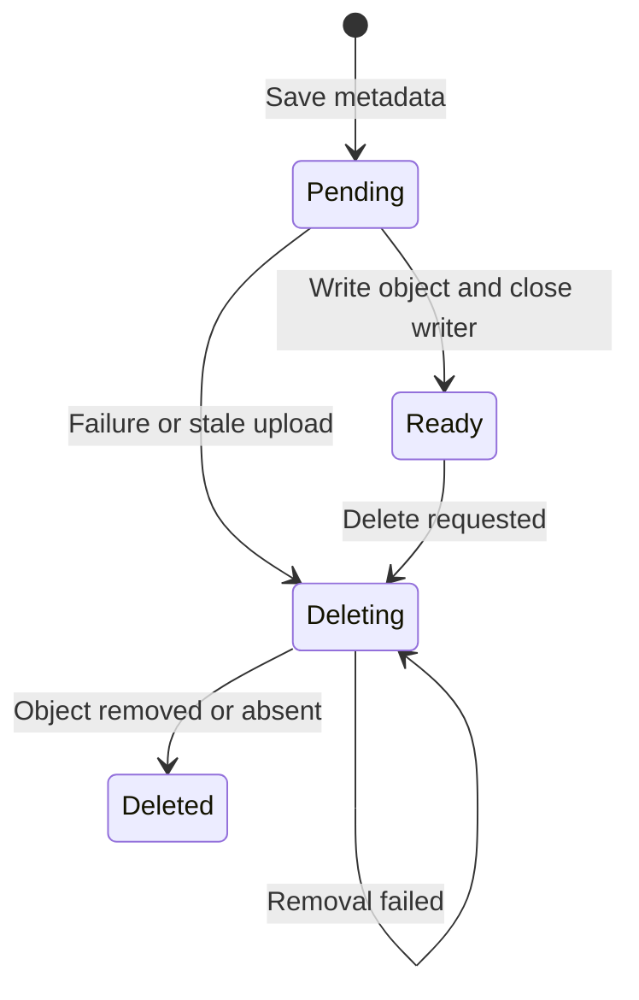

# Media assets

Media adds owned asset records, visibility, URLs and recoverable deletion above
[file storage](../../../docs/filesystems.md). PostgreSQL stores metadata; a named
Go CDK disk stores bytes. Use it for files attached to users or other business
models. Use raw storage for an object that needs no asset lifecycle.

## Before uploading

For a local first run, configure a disk and a client-reachable media origin:

```dotenv
FILESYSTEM_DISK=local
FILESYSTEM_LOCAL_ROOT=storage/app
FILESYSTEM_LOCAL_VISIBILITY=public
FILESYSTEM_LOCAL_URL_MODE=internal
MEDIA_BASE_URL=http://127.0.0.1:8080/api/v1/media
```

Keep the working PostgreSQL/Redis settings from [installation](../../../docs/getting-started.md).
Apply migrations with `go run ./cmd/cli migrate up`. The supplied HTTP routes also
require [Identity authentication](../../modules/identity/README.md); sign in and save the
access token before trying the commands below.

App supplies `Resources.Media`, a constructed `*media.Library`. Modules borrow
it; the library starts no workers and never closes app-owned buckets.

## Upload and use an asset

The default disk visibility is **public**. Upload a file through the existing API:

```sh
curl -i http://127.0.0.1:8080/api/v1/media \
  -H 'Authorization: Bearer ACCESS_TOKEN' \
  -F 'file=@photo.png'
```

Expect **201**. The response's `data` contains the asset ID, filename, content type,
size, collection, status, visibility and `url`. Use `data.url` to display the public
asset. Storage keys and disk names are deliberately omitted from HTTP responses.

For a sensitive document, choose private visibility explicitly:

```sh
curl -i http://127.0.0.1:8080/api/v1/media \
  -H 'Authorization: Bearer ACCESS_TOKEN' \
  -F 'file=@statement.pdf' \
  -F 'visibility=private'
```

The generic HTTP upload accepts exactly one `file` part and an optional visibility
field, uses the `default` collection, and limits the file to **20 MiB**. It does not
accept an arbitrary owner, disk or collection from the client. Build a business
route when those choices require your own policy.

### Upload from a business operation

After authorizing the target user, call the borrowed library:

```go
asset, err := library.Upload(ctx, media.UploadInput{
    Owner: media.Owner{
        Type: string(entities.UserEntityType),
        ID:   userID.String(),
    },
    Collection: "avatar",
    Filename:   filename,
    Body:       file,
    Policy: media.Policy{
        MaxBytes:     5 << 20,
        ContentTypes: []string{"image/jpeg", "image/png"},
    },
})
if err != nil {
    return err
}
```

This **service fragment** assumes `library`, `ctx`, `userID`, filename and an open
reader. Import `github.com/wisalgroup/labena/internal/platform/media` and
`github.com/wisalgroup/labena/internal/modules/shared/entities`. The caller closes its reader and supplies
its deadline. An explicit `Visibility: media.Private` overrides the disk default.
`Policy.Disk` selects an already opened disk; omission uses the default.

`Upload` returns an `Asset`, not an enriched HTTP response. Call `URL` after a
successful upload when you need a link. Decide how to report later link-resolution
failure without telling a client that its already committed upload rolled back.

### Validate upload policy

| Policy | Behavior |
| --- | --- |
| `MaxBytes` | Required; 1 byte through 1 GiB |
| `ContentTypes` | Optional list of detected MIME types; empty allows any detected type |
| `Disk` | Optional configured/opened disk name |
| Filename | Sanitized display metadata; never an object key |

Media sniffs a small prefix and streams the remainder with a byte limit. Generated
UUID keys prevent user filenames from choosing object paths. MIME detection does
not prove that content is malware-free or a decodable image. If your application
requires scanning, add a deliberate quarantine/processing policy before exposure.

## Public URLs and private links

Visibility and delivery mode are separate decisions:

| Visibility | Disk URL mode | `URL` / HTTP `url` | Reader needs |
| --- | --- | --- | --- |
| Public | `internal` | App `/media/{id}/content` | No bearer token |
| Private | `internal` | App `/media/{id}/download` | Owner's bearer token |
| Public | `direct` | Permanent provider/CDN URL | Public-read storage policy |
| Private | `direct` | Provider-signed URL, normally 15 minutes | Possession of the link |

New uploads inherit the selected disk's visibility; explicit upload visibility
wins. Changing the default affects new uploads only. Visibility is fixed for an
existing asset; replacing it creates another asset ID.

For direct mode, configure public prefixes, signing credentials and a
client-reachable endpoint as described in
[filesystem URL settings](../../../docs/filesystems.md#media-visibility-and-urls).
Local disks require internal mode. Internal mode does not remove a bucket's existing
public permissions.

### Resolve an existing asset URL

```go
asset, err := library.Get(ctx, owner, assetID)
if err != nil {
    return err
}
link, err := library.URL(ctx, asset)
if err != nil {
    return err
}
```

This **read fragment** assumes an already authorized `owner`. `Get` scopes the
record to that owner. **`URL` itself does not authorize** the supplied Asset or
reload its state: call it only after authorization. Private direct URLs grant
bearer access. A nil/non-ready asset yields an empty link.

`media.Link` exposes `URL` and `ExpiresAt`; zero expiry means a stable URL. Public
legacy objects whose keys lack `public/` retain internal URLs until an explicit
storage/metadata migration.

### Request a temporary link

For a private asset displayed where an Authorization header is impractical:

```sh
curl -i -X POST http://127.0.0.1:8080/api/v1/media/ASSET_ID/url \
  -H 'Authorization: Bearer ACCESS_TOKEN' \
  -H 'Content-Type: application/json' \
  --data '{"expires_in":900}'
```

Expect **200**, with `data.url` and `data.expires_at`. The endpoint authorizes the
owner and checks readiness. For Go callers:

```go
link, err := library.TemporaryURL(ctx, owner, assetID, 15*time.Minute)
if err != nil {
    return err
}
```

Import `time`. The Go API uses 15 minutes for zero duration; the HTTP field defaults
to 900 seconds. Allowed lifetime is 1 second through 24 hours.

| Response/call | Expiry field |
| --- | --- |
| Upload/list/metadata HTTP asset | `url_expires_at`, omitted for stable URLs |
| Temporary-link HTTP response | `expires_at` |
| `Library.URL` or `TemporaryURL` result | `Link.ExpiresAt` |

Links are reusable bearer credentials until expiry, not single-use tokens. They do
not end when an Identity session logs out. Provider credentials may expire before
the requested lifetime. Do not persist an expiring URL as an asset identifier;
store the asset ID and request a current link.

### Configure internal signing

Internal temporary links need a separate 32-byte secret:

```sh
openssl rand -base64 32
```

Store it as `MEDIA_SIGNING_KEY` and share it across replicas. Keep `MEDIA_BASE_URL`
at the exact public origin/path used by the registered routes. The application
default is `http://localhost:8080/api/v1/media`; direct `media.New` callers get
`/api/v1/media` when BaseURL is empty.

Without a key, public internal URLs and authenticated downloads still work;
internal temporary-link creation returns **503**. Direct temporary links use
provider signing instead. Rotating the media key or changing BaseURL invalidates
existing internal signatures.

### Understand link failures

Private direct signing can fail because a disk is missing, credentials cannot sign,
or the provider operation fails. `Library.URL` returns an authenticated internal
fallback **and an error** in that case.

The supplied upload HTTP handler returns its already committed asset with that
fallback. Metadata/list requests surface the signing error, and explicit temporary
link requests return an error. A successful upload response therefore does not
prove provider signing is configured. Always inspect the returned URL mode/expiry
when diagnosing client access.

### Content behavior

Internal content reads check ready state and visibility/signature on each request.
Private, missing, deleted and invalid-link assets return the same not-found result.
Supplying invalid signature parameters is rejected even for public assets.

App content uses `no-store`, `nosniff`, sandbox and no-referrer headers. Only an
allowlist of image/audio/video MIME types displays inline; HTML, SVG and other
active formats download as attachments. The download endpoint always uses an
attachment and `application/octet-stream`. This integration does not implement
range-request/video-streaming behavior.

Direct URLs bypass app headers, rate limits and metadata checks. A direct public
object can become readable as soon as its bytes exist, before metadata is marked
ready. It stops being directly readable when the object is deleted, subject to
provider/CDN caches. Choose internal delivery when these app checks are required.

## Relationships and collections

Every asset has one owner and one collection. The owner is the model the file
belongs to, not necessarily the actor uploading it. `user/42` and `admin/42` are
different owners. Add stable business type names in
`internal/modules/shared/entities/entity_types.go`; no platform model registry is needed.

An omitted collection becomes `default`. List a particular collection:

```go
page, err := library.List(ctx, owner, "avatar", pagination.NewPagination(1, 20))
if err != nil {
    return err
}
```

Import `github.com/wisalgroup/labena/pkg/pagination`. An empty collection filter lists all ready
assets for that owner. Type/collection names match `[a-z][a-z0-9_.-]{0,63}`;
owner IDs are nonempty UTF-8 strings up to 200 bytes without surrounding whitespace
or controls.

Collections group assets; they do not automatically enforce quotas, ordering or
single-avatar replacement. Define those rules in the business operation. For
replacement:

1. Upload and validate the new asset.
2. Commit the business relationship to the new asset ID.
3. Delete the old asset after commit, retaining failures for recovery.

If relationships require deletion checks, adapt or disable the generic delete
route; Media cannot infer arbitrary future relationships. There is no many-to-many
shared-attachment registry.

### Delete an owner safely

Polymorphic references cannot enforce foreign keys across arbitrary owner tables.
The business operation checks existence and access, stops new uploads for a
deleting owner, coordinates in-flight work, then deletes assets through Library.
Deleting the owner row or publishing a best-effort local event alone does not
remove blobs.

```go
if err := library.Delete(ctx, owner, assetID); err != nil {
    return err
}
```

Delete is owner-scoped and repeatable for retained tombstones. A foreign owner
cannot delete the record. `Open` also checks ownership/readiness and returns a
native reader which its caller must close.

## Disks and lifecycle

`Resources.Disks` contains app-owned opened buckets; `DefaultDisk` selects one.
Media copies the map and borrows the bucket pointers. Construct independently
inside this application template using existing clients:

```go
library, err := media.New(db, disks, defaultDisk, media.Config{
    BaseURL:    "/api/v1/media",
    SigningKey: signingKey,
    Disks:      diskOptions,
})
if err != nil {
    return err
}
```

This **construction fragment** assumes a Bun DB, named native buckets and validated
options. It opens nothing and starts no goroutines. Use `integration.Register`
for public/signed content serving, CLI, jobs and migrations. Identity registers
user management endpoints separately through its own HTTP delivery. Platform
media imports no business modules or shared business definitions.

Keep names/backing locations stable while assets reference them. Changing the
default affects new uploads; changing an endpoint does not migrate objects.
Copy/verify bytes and update metadata explicitly when changing providers. Local
storage needs an intentionally shared filesystem across replicas. Remote
permissions must match the selected visibility/URL policy.

### Upload and deletion state



Blob I/O cannot join a SQL transaction. `Upload`, `Delete` and `Recover` reject a
caller SQL transaction context. Upload has a two-minute deadline; failed/canceled
uploads attempt cleanup with a separate five-second budget and preserve cleanup
errors. SQL metadata remains recoverable if cleanup fails.

Deletion stores intent before touching bytes. Missing objects count as removed;
metadata becomes a tombstone only after removal. Unready uploads remain eligible
for repeated deletion through the ten-minute crash grace to catch late remote
writes after cancellation.

### Recover interrupted work

```sh
go run ./cmd/cli media recover
```

Recovery marks uploads older than ten minutes for cleanup and attempts at most
100 deletion rows per batch. Failed rows rotate through the backlog; concurrent
and repeated runs are supported. It scans known metadata, not arbitrary bucket
objects. A provider capable of completing writes beyond this grace requires a
longer deliberate recovery policy.

App schedules `media.recover.v1` every five minutes when disks exist. Run one
scheduler and workers, or invoke recovery through an operator schedule. Monitor
old pending/deleting rows and task failures. Back up metadata and objects together;
a database restored behind its bucket needs explicit inventory reconciliation.
Tombstone retention is a separate policy because removing tombstones changes
repeated-delete behavior.

## HTTP and CLI

Identity owns the authenticated user management routes in
`internal/modules/identity/delivery/http/media_handler.go`, with registration in
Identity's `routes.go`. Platform media integration
owns only the public/signed content route and generic streaming behavior.

All routes below are beneath `/api/v1`:

| Method and route | Behavior |
| --- | --- |
| `POST /media` | Owner-authenticated multipart upload; **201** |
| `GET /media?page=1&per_page=20&collection=avatar` | Owner-scoped ready assets |
| `GET /media/{id}` | Owner-scoped metadata and resolved URL |
| `GET /media/{id}/download` | Owner-authenticated attachment |
| `GET /media/{id}/content` | Ready public content or a valid signed link |
| `POST /media/{id}/url` | Owner-authorized temporary link |
| `DELETE /media/{id}` | Owner-scoped deletion; **204** |

The current user's ID determines management ownership; callers cannot substitute a
body owner. Metadata stays private even for public bytes. The upload adapter bounds
the complete multipart body and cleans temporary files.

Trusted operators can select other owner types:

```sh
go run ./cmd/cli media upload user USER_ID ./document.pdf --collection documents --visibility private
go run ./cmd/cli media list user USER_ID --collection documents
go run ./cmd/cli media delete user USER_ID ASSET_ID
go run ./cmd/cli media recover
```

CLI output is the capability record, not the enriched HTTP AssetResponse. Use the
HTTP metadata endpoint or `Library.URL` when you need a resolved URL.

## Compatibility and extension

The visibility migration preserves existing rows as private and defaults new rows
to public. Apply it with `migrate up`; no database reset is needed. Internal mode
needs no public bucket policy. Direct public mode requires explicit scoped
permissions, as documented in [file storage](../../../docs/filesystems.md).

Image variants, antivirus scanning, direct-upload verification and video processing
are extension work. Native storage can create signed PUT URLs, but Media does not
provide a managed direct-upload/finalization flow. Use bounded jobs carrying asset
IDs when adding processors. Business workflows decide whether an outcome should
notify; Media does not automatically call Notifications.

## Troubleshoot and verify

| Symptom | Check |
| --- | --- |
| Public URL returns not found | Ready metadata, visibility and disk/object availability |
| Private URL fails in an image element | Internal download needs a bearer header; request a temporary link |
| Direct link uses `minio:9000` | Provider endpoint must be reachable by the client, not only app containers |
| Signature fails after replacing its hostname | Signatures cover the original host; configure the endpoint before signing |
| Temporary internal link returns 503 | Shared `MEDIA_SIGNING_KEY` configuration |
| Public direct link returns access denied | Read-only policy on `public/*`, account restrictions and correct PublicURL |
| Upload succeeded but returned an internal download URL | Provider signing failed and the upload adapter used its fallback |
| Deleted direct content is still visible | Object removal or CDN/provider caching |

Tests cover owner separation, visibility, URL modes, cleanup and recovery. Use
[disposable integration services](../../../docs/testing-database.md) to verify
PostgreSQL and storage behavior; local/MinIO tests do not establish real-cloud
permissions. Continue with [file storage](../../../docs/filesystems.md),
[scheduling](../../../docs/scheduling.md), and [observability](../../../docs/observability.md).
