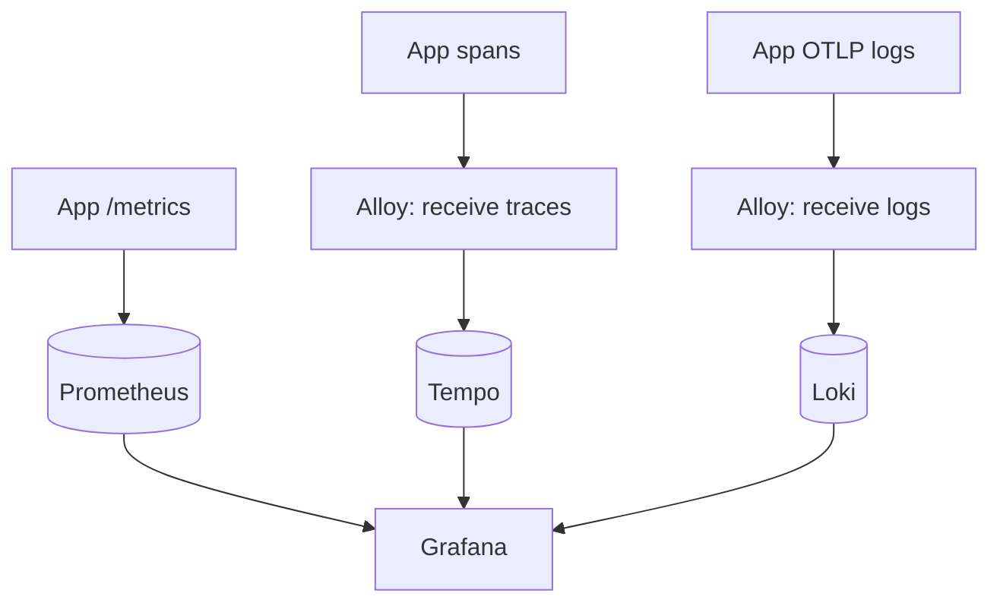

# Observability

Logs describe individual outcomes. Metrics show rates, latency and capacity over
time. Traces connect operations across HTTP requests, dependencies, tasks and events.
The app supplies boundary instrumentation; add business signals only where useful.

## Choose where to start

| Question | Start with | Continue to |
| --- | --- | --- |
| Why did this request fail? | Its `request_id` in Loki | The linked Tempo trace and safe error code |
| Which query made it slow? | The request trace | Database child spans and sanitized `db.query.text` |
| Is latency increasing for everyone? | Prometheus route latency/rate | Representative traces and pool/backlog signals |
| Why is background work delayed? | Queue backlog and task state | Worker attempts and the notification ledger |
| Is the process healthy? | Liveness, readiness, scrape health | The specific dependency or lifecycle signal |

You do not need to add custom spans before investigating normal HTTP, database,
cache, task, and event boundaries. First use the instrumentation already installed.

## Start the local stack

Grafana is the UI; Prometheus stores metrics, Tempo stores traces, Loki stores logs,
and Alloy receives logs and spans over OTLP/HTTP. Application log files are not collected.



With the existing Tilt development environment:

```sh
tilt up
```

Tilt starts observability by default; use `-- --observability=false` to disable it.
For an already-running session with explicit arguments, use
`tilt args -- --observability=true` to enable it again (retain any other desired flags).
Alternatively, start the complete Compose profile:

```sh
docker compose --env-file deployments/observability/compose.env   -f deployments/compose.yaml up --build -d
```

Choose one setup because their host ports overlap. The Compose environment file
starts backends **and** enables app signals; `--profile observability` alone does
not configure the app. Shell environment overrides still apply.

Open [Labena · Overview](http://localhost:3000/d/go-modular-overview). Data
sources and the dashboard are provisioned. Local Grafana permits anonymous Viewer
access, so a login form is not required to view data. Both full profiles select
`stderr,file,observability` log channels: readable console, readable daily files,
and direct OTLP log export. The application's current root sampling
default is 100%; the Compose observability profile also explicitly selects 100%.
`TRACING_SAMPLE_RATIO` can reduce the volume outside local exploration.

Tilt forwards Alloy's OTLP endpoint to localhost:4318 for host applications.
Prometheus's supplied app target is the Kubernetes `api:9090` service; scraping a
separate host process requires a corresponding scrape target.

## Follow your first request

With the local app and observability stack running:

```sh
curl -i http://localhost:8080/healthz
curl -i http://localhost:8080/readyz
```

The response includes `X-Request-ID` and `X-API-Version`. Copy the request ID, open
Grafana Explore, select Loki, and filter on it using the steps below. Health probes
show the HTTP boundary; make an authenticated `GET /api/v1/users/me` request when
you want to inspect database work too:

```sh
curl -i http://localhost:8080/api/v1/users/me \
  -H "Authorization: Bearer $ACCESS_TOKEN"
```

Set `ACCESS_TOKEN` to a current application access token. A successful account
response includes the same request ID in its JSON envelope. Do not share the token
when reporting a failure.


Allow a scrape/export interval, then check application scrape health, request rate
and duration. Expand an HTTP log in Grafana and follow its trace link. Generate
[task](queues.html#try-the-existing-task) and [event](events.html#signup-flow)
work to see their signals; unused capabilities have no measurements.

A log's trace ID does not guarantee a stored trace. Sampling, dropped exports and
retention can all explain a missing trace. Scrape health proves the endpoint is
reachable, not that every application dependency is healthy.

## Filter logs by request metadata

The observability channel sends log attributes such as `request_id` directly over
OTLP. Loki stores these attributes as structured metadata, alongside native
`trace_id`, `span_id` and `severity_text` fields. It is available to Loki queries in Explore and dashboard log
panels without adding a JSON parser. It is not an indexed stream label, so it does
not appear in the initial stream-label selector.

In Explore's Builder, select `service_name = labena`, then add a **Label filter**
operation for `request_id`, choose `=`, and enter the request ID. The equivalent
query is:

```logql
{service_name="labena"} | request_id="YOUR_REQUEST_ID"
```

For new OTLP records, filter severity with `severity_text="WARN"` or
`severity_text="ERROR"`. The environment resource field is
`deployment_environment_name`. These replace the old file pipeline's `level` and
`environment` fields; `request_id` keeps its name. Log lines contain the message,
while their attributes are available as metadata.

This applies to newly exported OTLP logs after the app and collector restart.
Older JSON log records still require JSON parsing to filter their request ID.
Logs without a request ID do not match a specific ID filter. No dashboard textbox
is required; each query chooses its own filter. Prometheus metrics remain aggregate
measurements, and Tempo traces are reached through a matching log's **View trace**
link.

### Understand metadata and labels

| Field | Where to use it | Why |
| --- | --- | --- |
| `service_name` | Loki stream selector | Groups a bounded application identity |
| `request_id`, `trace_id`, `span_id` | Structured metadata filter | Identifies one execution without creating an indexed stream per request |
| `severity_text` | Metadata filter | Native OTLP severity such as `WARN` |
| `deployment_environment_name` | Resource metadata filter | Environment reported by the process |
| HTTP route template | Metrics labels and spans | Groups a bounded operation rather than raw user paths |

Grafana's Builder can filter metadata using a Label filter operation even though it
is not an indexed stream label. Suggestions depend on the selected data and time
range. A field may be entered by name when it is absent from suggestions.

Do not add `| json` to parse a new OTLP log's message as though it were the former
JSON file record. Applying a parser to records with existing fields can create
`*_extracted` duplicates. Older retained file records may still use `level` and
need JSON parsing; choose the query for the records' actual format.

## Configure log export

Include `observability` in `LOG_CHANNELS` to enable the OTLP driver. To avoid local
files completely, select `stderr,observability`; to retain readable daily files,
select `stderr,file,observability`.

```dotenv
LOG_CHANNELS=stderr,file,observability
OTEL_EXPORTER_OTLP_LOGS_ENDPOINT=http://localhost:4318/v1/logs
```

Use `http://alloy:4318/v1/logs` inside the supplied containers. Tilt and Compose
configure that address; host applications use localhost. The endpoint is a full
OTLP/HTTP URL. Authentication belongs at the collector; URL credentials, queries
and fragments are rejected. `APP_NAME` and `APP_ENV` identify the source.

Log export works independently of tracing, trace sampling, metrics and local file
output. Console and daily file formats stay readable. The observability channel
creates no `observability.log`, and Alloy has no access to application log files.
Existing files are left untouched and are not replayed into Loki.

The application queues at most 2,048 records and exports batches of up to 512,
with a one-second interval and five-second request timeout. Queue saturation drops
oldest records; failed batches are discarded and reported to stderr without raw
payloads or endpoint details. Alloy retries its own forwarding with bounded queues.
These queues are in memory: outages or process crashes can lose logs. Daily files
are an independent local copy, not an automatic export retry buffer.

At shutdown, app stops producers, closes dependencies, then flushes log export
within three seconds or the remaining cleanup deadline, whichever is shorter.
`OTLPOptions` in the channel definition allows different timeout budgets. Collector
availability is not required at startup or for readiness.

## Configure tracing

Without the supplied local profile, configure OTLP HTTP explicitly:

```dotenv
TRACING_ENABLED=true
TRACING_TRUST_INCOMING=false
APP_NAME=labena
OTEL_EXPORTER_OTLP_TRACES_ENDPOINT=http://localhost:4318/v1/traces
TRACING_SAMPLE_RATIO=1
TRACING_EXPORT_TIMEOUT=5s
TRACING_SHUTDOWN_TIMEOUT=3s
```

Tracing defaults to disabled and the default root sampling ratio is 1. Use a
reachable collector hostname inside containers, not host loopback. The endpoint
is the full traces URL; credentials, queries and fragments are rejected.

Incoming HTTP trace context is ignored unless `TRACING_TRUST_INCOMING=true`.
Enable trust only behind controlled ingress: parent-based sampling follows the
trusted parent's sampling decision. Only W3C trace context is imported, not baggage.
Trace headers are correlation metadata, not identity or authorization.

Invalid enabled settings fail validation; collector outages do not block startup.
Disabled tracing uses a no-op provider and starts no exporter. App instances own
providers explicitly without replacing OpenTelemetry globals. Independent callers
use `tracing.Open(ctx, cfg, logger)` and own `provider.Shutdown(ctx)`. Opening enabled
tracing starts its bounded export worker, so cleanup is required even if no spans
were recorded. Stop producers before shutting it down.

## Enable metrics

```dotenv
METRICS_ENABLED=true
METRICS_ADDRESS=127.0.0.1:9090
```

```sh
curl http://127.0.0.1:9090/metrics
```

Metrics work independently of tracing and use an app-owned registry. Disabled mode
opens no listener. Selected app/worker/scheduler processes and `cli serve` expose the listener;
one-off commands do not. Give separate host processes different ports.

For private scraping across containers, bind `:9090`. This listener has no auth or
TLS and should not be publicly exposed. It stores no history itself. It remains
available during business-service drain and stops before provider cleanup.

## Available metrics

| Metric family | Meaning |
| --- | --- |
| `http_server_request_duration_seconds` | Completed HTTP latency histogram and request count |
| `http_server_active_requests` | Active ordinary requests |
| `db_client_operation_duration_seconds` | Bun query latency by operation and outcome |
| `db_pool_connections`, `db_pool_max_connections` | Local pool occupancy and capacity |
| `db_pool_waits_total`, `db_pool_wait_duration_seconds_total` | Pool contention |
| `cache_operation_duration_seconds` | Cache operation latency and hit/miss/error outcomes |
| `queue_job_duration_seconds` | Task attempts by registered task pattern, queue and outcome |
| `notification_delivery_attempts_total` | Persisted channel delivery attempts by channel and outcome |
| `notification_pending_age_seconds` | Dispatcher-sampled age of the oldest unsettled notification intent |
| `asynq_queue_size`, `asynq_queue_latency_seconds` | Redis backlog and oldest pending latency |
| `asynq_tasks_enqueued_total` | Native state gauge despite its name |
| `watermill_events_*` | Official Watermill publication, subscription and handler metrics |
| `go_*`, `process_*`, `target_info` | Runtime, process and service metadata |

The existing `queue_job_*` and `job_name` names remain compatibility surfaces even
though guides use task terminology. Route templates and registered task patterns
keep labels bounded. IDs, URLs, keys and payloads are not metric labels.

HTTP request rate:

```promql
sum by (http_route) (rate(http_server_request_duration_seconds_count[5m]))
```

HTTP p95 latency:

```promql
histogram_quantile(0.95,
  sum by (le, http_route) (rate(http_server_request_duration_seconds_bucket[5m]))
)
```

Add Prometheus `job` or `instance` selectors to isolate a deployment. Counts reset
on restart; use rates rather than interpreting process counters as business records.

## HTTP tracing

Standard HTTP middleware records method, registered route and final status. Unknown methods
become `_OTHER`; unmatched paths are not copied into span names. 5xx responses,
recovered panics and observed cancellation mark failures; 4xx remains a status
attribute. Bodies, raw paths, queries, credentials and client IPs are omitted.

Health requests are included. Streaming spans last until the handler returns.
WebSocket upgrades are excluded from HTTP spans and metrics; their request logging
and shutdown still apply. Redirects pass through the same observability boundary.

## Correlate logs with the current span

Use the context-aware slog API supplied by `pkg/logging`:

```go
logging.FromContext(ctx).InfoContext(ctx, "order accepted", "order_id", orderID)
```

The logger adds `trace_id`, `span_id` and `trace_sampled` from the current context.
Named channels preserve correlation. `Info(...)` has no operation context; use
`InfoContext`. An unrelated logger or fallback `slog.Default()` is not automatically
wrapped. Unsampled contexts still have IDs, but no recorded span.

Alloy forwards OTLP logs to Loki without collecting duplicate console/file output.
Request and trace IDs remain metadata, not indexed stream labels. The service label
comes from `APP_NAME`; update dashboard selectors when changing it.
Grafana's **View trace** uses the `trace_id` metadata field. Tempo's logs link also
filters on metadata, so it does not depend on a trace ID appearing in the message.

## Create a span

In app assembly, create a native tracer and pass it to the service that needs it:

```go
tracer := a.resources.TracerProvider.Tracer("github.com/wisalgroup/labena/catalog")
```

Inside that service operation:

```go
ctx, span := tracer.Start(ctx, "catalog.import")
defer span.End()
if err := importProducts(ctx); err != nil {
    span.SetStatus(codes.Error, "import failed")
    return err
}
return nil
```

This is a workflow fragment: implement `importProducts` and import OTel `codes`.
Pass the derived context onward. Use stable names and sanitized status descriptions;
do not record raw provider errors or payloads as span attributes.

## Add a custom metric

Create instruments once during app assembly and inject them into the consumer:

```go
meter := a.resources.MeterProvider.Meter("github.com/wisalgroup/labena/catalog")
created, err := meter.Int64Counter("catalog.products.created",
    metric.WithDescription("Products successfully created"),
)
if err != nil {
    return err
}
```

Import `go.opentelemetry.io/otel/metric`. Record `created.Add(ctx, 1)` after success.
Do not attach a product ID as a label. No-op providers permit the same calls when
metrics are disabled. The SDK bounds attribute sets; that is a safety limit, not
a substitute for low-cardinality labels.

## Database queries and pool metrics

The app instruments its Bun pool once. Queries using the operation context and
transaction executor retain logging and telemetry. Spans record bounded operation
names. Recorded spans also include sanitized SQL in `db.query.text`: literal values
and parameter placeholders become `?`, and comments are removed. DSNs, parameter
values and raw driver errors are never attached. Missing rows are not failures.

### Inspect a request's SQL in Grafana

After restarting the app with this version, make a request that queries the database
and copy its `X-Request-ID` response header. Then:

1. Open Grafana **Explore**, select **Loki**, and find the request's log using its
   request ID. For example: `{service_name="labena"} | request_id="YOUR_REQUEST_ID"`.
2. Expand the log and follow **View trace**, or copy its `trace_id` into a **Tempo**
   trace-ID lookup.
3. Select a child database span (`SELECT`, `INSERT`, `UPDATE` or `DELETE`) and expand
   its attributes. `db.query.text` contains the query structure, for example
   `SELECT "user"."id" FROM "users" AS "user" WHERE email = ?`.

The span shows the query's duration and status. SQL is available only for newly
recorded traces, not historical traces or unsampled requests. Existing tracing
settings control capture; SQL does not require DEBUG logging. Database logs remain
metadata-only, and SQL is never used as a metric label.

Capture supports single read/write statements, including CTEs, for PostgreSQL,
MySQL and SQLite. Table, column and alias names remain visible, so keep application
data out of identifiers. SQLite double-quoted tokens are redacted because they can
also represent string values. For safety, text is omitted for administrative or
multiple statements, unsupported/malformed tokens, nested block comments,
ambiguous backslash escapes (quoting depends on connection settings), and SQLite
bracket/backtick identifiers. Input over 64 KiB or sanitized text over 8 KiB is also
omitted. PostgreSQL hex literals used by Bun for binary values, such as verification
digests, are supported and replaced with `?`. These omissions do not affect
execution or the span's timing/status.

This follows OpenTelemetry's [sanitized SQL guidance](https://opentelemetry.io/docs/specs/semconv/db/database-spans/#recording-query-text).

### Instrument another pool

Pool measurements read local `database/sql` statistics without querying the server.
Direct `db.DB` calls, connection probes and SQL-only migration paths bypass Bun
query hooks. Query duration is not necessarily server-only execution time.

For another app-owned Bun connection, install before concurrent use:

```go
unregister, err := database.Instrument(db, "reporting",
    a.resources.TracerProvider, a.resources.MeterProvider,
)
if err != nil {
    return err
}
```

Register cleanup immediately. Stop users, call `unregister()`, then close the pool.
Unregister removes pool observation; Bun hooks cannot be detached. Do not instrument
the primary pool twice.

## Redis and cache operations

Configured cache drivers get logical operation tracing/metrics. Misses differ
from failures; keys and values are omitted. App's cache Redis client can also carry
the native tracing hook. The Asynq connection is instrumented through task middleware
and its collector; it does not currently install that Redis command hook.

For a separately constructed go-redis client, attach once before use:

```go
client.AddHook(redis.NewTracingHook(
    a.resources.TracerProvider.Tracer("github.com/wisalgroup/labena/redis"),
))
```

Here `redis` imports `github.com/wisalgroup/labena/pkg/redis`. The hook records allowlisted commands
and pipelines without keys, arguments or raw errors. It does not add retries.
`cache.WithTelemetry(store, tracerProvider, meterProvider)` similarly wraps an
independent store without taking ownership of its clients.

## Trace queues and events

Global Asynq client middleware traces `EnqueueContext` and injects W3C headers into
initialized task header maps. Native worker middleware links each consumer attempt
to its producer, records duration and adds contextual logs. Schedules bypass the
client chain, so executions have worker spans without a stale startup producer.

Watermill's publisher copies propagation metadata; handler middleware preserves
subscriber cancellation and links each attempt to the producer. Linked consumer
spans are independently sampled; do not expect one continuous parent/child tree.

The app uses official Asynq and Watermill Prometheus integrations. Small native
middleware adapters provide the app's tracing and sanitization policy; business
services use native tasks and messages. Asynq scrapes query Redis and can fail when
Redis is unavailable. Handler metrics alone do not describe backlog or durability.

## Trace outgoing HTTP requests

Construct and reuse a client in app assembly for an integration allowed to receive
trace metadata:

```go
transport := http.DefaultTransport.(*http.Transport).Clone()
client := &http.Client{
    Transport: tracing.NewHTTPTransport(transport,
        a.resources.TracerProvider.Tracer("github.com/wisalgroup/labena/payments")),
    Timeout: 10*time.Second,
    CheckRedirect: func(req *http.Request, via []*http.Request) error {
        return http.ErrUseLastResponse
    },
}
```

Use `net/http`, `time` and `github.com/wisalgroup/labena/pkg/tracing`. Pass request contexts with
`http.NewRequestWithContext`; close response bodies and bound their size. App
cleanup should call `client.CloseIdleConnections()` after users stop.

The wrapper clones headers, injects W3C context and removes baggage. Spans measure
through response headers, not body consumption. It adds no retry or global client
changes. If redirects are enabled, authorize each destination for propagation.

## Trace mail sends

The app always constructs mail. Its assembly wraps SMTP sending for tracing; use
the same wrapper for an independently constructed mailer:

```go
mailer := mail.WithTracing(smtpMailer,
    a.resources.TracerProvider.Tracer("github.com/wisalgroup/labena/mail"),
)
```

`mail.send` measures submission without recipients, bodies or raw provider errors.
It changes neither ownership nor retries. Success means submission, not inbox delivery.

## Console commands

With tracing enabled, command execution has a `console.execute` span carrying its
registered command path, not arguments or flag values. Commands pass `cmd.Context()`
to services. One-off commands flush on cleanup but start no metrics listener.
All CLI commands use application construction, including help and table publication;
construction can open exporters but does not start application runners.

## Export and shutdown behavior

Spans use a bounded in-memory batch queue. Full queues drop spans; exporters have
timeouts and no app-side retries. Alloy owns bounded backend retry policy. Failed
exports are reported through redacted, rate-limited logging. Telemetry is best-effort,
not a durable audit log.

App shutdown stops work before flushing tracing and closing logging. Flush deadlines
and process termination can lose diagnostics. A timed-out exporter can still be
finishing its bounded network operation. Successful cleanup does not prove storage
at the backend.

## Retention, resources and failures

Local Prometheus, Tempo and Loki target 24-hour retention. Deletion is asynchronous;
WALs and in-flight data add overhead. Docker volumes and PVC requests are not reliable
hard disk limits. Monitor local disk use and consult `deployments/observability`
for component memory limits and pinned backend configuration.

The observability channel sends logs directly; no source file needs rotation.
Readable daily app files have their own [retention policy](logging.html#single-or-daily-files),
independent of Loki retention. Alloy does not read or backfill those files.

Backends are not app readiness dependencies. During an outage, requests continue,
exports may be lost; local file output follows its configured rotation and retention policy. Local volumes retain data across
ordinary restarts, but provide neither high availability nor backups.

## Troubleshooting

| Symptom | Check |
| --- | --- |
| Scrape health is 0 | Metrics enabled, private `:9090` binding, Prometheus target |
| Logs missing | Observability channel selected, OTLP endpoint reachable, Alloy export status, Loki structured metadata enabled |
| Traces missing | Sampling, reachable OTLP endpoint, Alloy and Tempo readiness |
| Trace link missing | Context-aware logging and valid span context |
| Trace ID exists but Tempo has no trace | Sampling, export loss, retention, time range, and the correct deployment |
| Database span has no query text | Supported single statement and sanitization/size limits; timing still records |
| SQL is absent from Loki | Expected: logs contain metadata; inspect `db.query.text` in Tempo |
| Request ID missing in a metric filter | Expected: request IDs are not metric labels |
| Grafana “Failed to fetch” | Backend readiness and logs, browser connection, exhausted container resources |
| TraceQL reports an empty ring | Tempo generator/local-block configuration and generator readiness |
| Tempo connection refused | Tempo is listening on the configured OTLP port and has finished startup |

Check the relevant Tilt resource or Compose service logs before changing application
instrumentation. These messages identify a failing boundary, not one guaranteed cause.

## Production boundary

The supplied stack is local: anonymous Grafana viewing, no ingestion authentication,
local storage and no high availability. Wider deployment needs explicit access
control, TLS, backups, retention, alert ownership and per-replica OTLP delivery.
No dashboard or metric alone establishes exactly-once processing or data integrity.

Service identity belongs to `config.App.AppName`, loaded from
`APP_NAME`. Metrics, tracing and log export share it when enabled;
the application name is exported using the standard `service.name` resource attribute.

### Rate limiting

The shared limiter emits `ratelimit.decisions` and `ratelimit.duration` when metrics
are enabled, plus `ratelimit allow` spans when tracing is enabled. The bounded
`outcome` label separates normal admissions (`allowed`), policy rejections
(`denied`), unclassified failures (`error`), cancellation (`canceled`) and deadline
expiry (`timeout`). An error is not permission to proceed; callers retain their
existing failure behavior. API and Identity limits share these signals.

Use rising `denied` counts to investigate rejected traffic; rising `error` or
`timeout` counts can indicate limiter infrastructure trouble. These aggregate
signals do not identify a user or policy. Keys, destinations, policy values and
backend error messages are excluded to avoid exposing personal data or secrets.

### Safe failure diagnostics

HTTP operation, task-attempt and local-event failure logs include `error_category`: `canceled`,
`timeout`, `network`, or `other`. Wrapped causes are recognized without exporting
error text. Categories describe failures; they do not decide retries. Existing
`error_type` fields remain available where already emitted.

The local-event `message processing failed` record sits outside the configured
retry middleware: it reports a failed processing cycle after retries, or early
cancellation/timeout. It is not proof of durable delivery or a dead-letter queue.
Use its handler, topic and message ID to investigate; GoChannel events can be lost.
Attempt spans retain their error status but no longer emit a per-attempt
`retry_budget_exhausted` warning. Update queries that depended on that field.
HTTP failures expose a safe `error_code` alongside the category, never raw causes.

`application shutdown timed out` reports that the drain budget expired. Inspect
active handlers for cancellation support. The app does not claim to have stopped
uncooperative goroutines or safely closed their dependencies.

Queue backlog uses the native Asynq Prometheus collector. Scheduler publication
uses the native post-enqueue callback; worker traces describe execution separately.
The notification delivery ledger has a separate lifecycle from Asynq. Inspect
`notifications deliveries --status failed` and monitor counts/age in
`notification_deliveries`; see [Notifications](notifications.html). The notifier
also records delivery attempts and the age of the oldest unsettled intent when
metrics are enabled. The dispatcher samples pending age for `pending`, `sending`
and `awaiting_receipt` rows; an empty ledger records zero. These signals complement
Asynq backlog because an intent can be waiting in SQL before a task reaches Redis.

Use the native tracer/meter contracts for extensions. The framework adapters
supply correlation, sanitization, and lifecycle behavior at shared boundaries.

### Operational signal coverage

| Situation | Signal | Limit |
| --- | --- | --- |
| HTTP failures and latency | Route-based request histogram and access logs | No URL/query values in metric labels |
| Limiter rejection or failure | Decision counter, duration and outcome | No per-user or per-destination breakdown |
| Queue backlog | Native Asynq collector on the metrics listener | Requires queue Redis to answer scrapes |
| Task attempt failure | Attempt histogram, trace, task ID and safe error category | A retryable failure is not terminal completion |
| Local event processing failure | Watermill handler metrics and outer failure log | Retries are in memory; no durable recovery guarantee |
| Scheduled publication failure | `scheduled task enqueue failed` with safe category | Publication success does not prove task completion |
| Notification delivery backlog | Delivery attempts and oldest unsettled intent age | Age is sampled by a running dispatcher; no per-recipient labels |
| Shutdown budget exceeded | `application shutdown timed out` | Does not forcibly stop handlers |
| Trace collector failure | Rate-limited `trace export failed; batch discarded` | Exported spans may be lost; buffer overflow also drops spans |
| Dependency unavailability | Optional `/readyz` probes | Connectivity only; not schema or workflow validation |

Tracing uses an asynchronous bounded buffer. A regression test blocks a real OTLP
HTTP endpoint, fills the production batch buffer, and completes 4,096 additional
instrumented HTTP operations while export remains blocked. Separate tests cover
collector error-response redaction and bounded shutdown. This verifies isolation
for those paths, not a throughput benchmark or a promise of lossless telemetry.

## Verify a custom signal

When adding a business span or metric:

1. Create the instrument once during construction and inject it into its consumer.
2. Exercise one successful and one failed operation with real operation contexts.
3. Check the signal name, attributes, units, and correlation in the intended backend.
4. Disable the corresponding exporter and verify business behavior still works.
5. Check that IDs, credentials, payloads, and raw provider errors are absent from
   metric labels and routine span/error fields.

Use stable attributes whose possible values you can enumerate. A telemetry timeout
or missing export is not evidence that the business action failed. Continue with
[logging](logging.md), [application lifecycle](application-lifecycle.md), and
[deployment recovery](deployment.html#recovery-and-retained-state).
