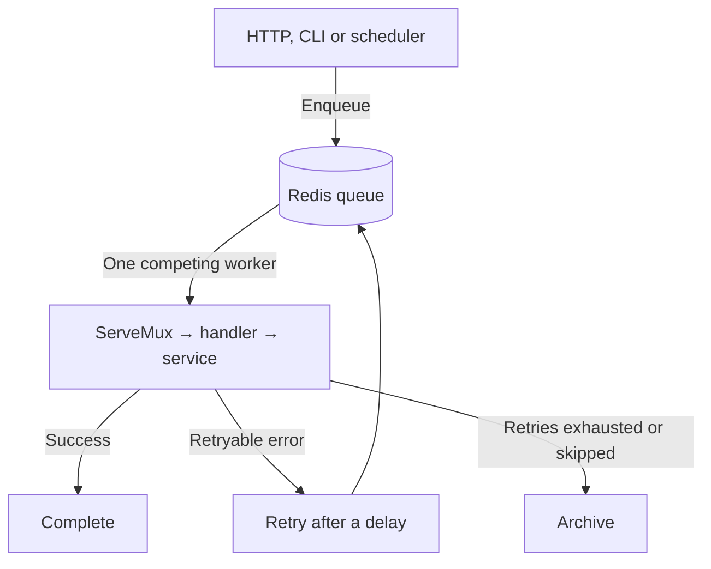
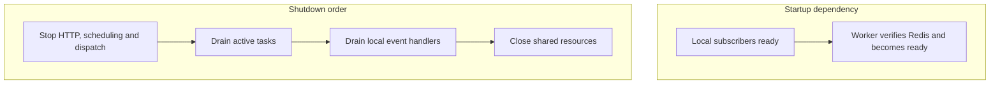

# Queues and tasks

A task asks a worker to do one operation later. The producer submits it to Redis;
a worker selects its handler and processes it outside the original request.
Use a queue for work that needs retries, delayed execution, or survival across
application restarts.



Several workers compete for tasks from the same queue. They do not each receive a
copy. Retries and recovery can deliver a task again, so handlers must tolerate
repeat execution. For independent reactions to one fact, see [events](events.html).

Choose the entry point that fits the operation:

| Need | Use | Success acknowledges |
| --- | --- | --- |
| Run one operation later | `queue.EnqueueContext` | Redis accepted a task |
| React to a fact in the current process | [Events](events.html) | Local publication, not completion |
| Run an operation repeatedly | [Scheduling](scheduling.html) | A future tick may enqueue a task |
| Commit a notification with a business write | [Notifier.Enqueue](notifications.html#send-immediately-or-queue-durably) | SQL intent, subject to commit |

The task model, options, handler and administration APIs are native Asynq. The
framework adds shared routing, observability, transaction guards and lifecycle
ownership. There is no additional Job interface to learn.

## Try the existing task

Use the configured profile from [installation](index.html). Redis, PostgreSQL,
the application migrations and an existing Identity user are required. For automatic
signup, enable and configure [authentication](identity.html) first. The minimal
quickstart keeps authentication off; it cannot create a user through OTP as-is.

Run the combined app, which includes workers by default:

```sh
go run ./cmd/app
```

In another terminal, enqueue the existing welcome task for a real user ID:

```sh
go run ./cmd/cli identity welcome '<user-id>'
go run ./cmd/cli notifications list user '<user-id>'
```

Use the same environment file and database/Redis settings in both terminals.
The command prints a task ID after Redis accepts the work. The worker then reloads
the account and persists eligible notification channel intents. A worker-owned
dispatcher scans those intents every second; delivery workers attempt each channel.
The list may initially be empty while that work is pending.

Welcome uses a stable key per recipient and channel. Repeating the command does
not create another database welcome notification. Verified addresses also receive
email when a mailer is available. The normal app always supplies its configured
mailer, but SMTP must be reachable for email to succeed. No cron scheduler is
required for notification delivery.

## Distinguish the names

| Name | Example | Purpose |
| --- | --- | --- |
| Task type | `identity.welcome.v1` | Selects the handler; a persisted contract |
| Task ID | Generated by Asynq | Identifies one submitted task |
| Queue | `default` or `high` | Selects the workload from which workers pull |
| Handler | Identity welcome handler | Reloads the account and persists channel intents |

Task types are persisted contracts: renaming one requires a plan for queued tasks.
The application uses native Asynq tasks, without a Job interface.

## Keep task code with its module

| File | Owns |
| --- | --- |
| `internal/modules/identity/jobs/welcome.go` | Stable task type, serializable payload and constructor |
| `internal/modules/identity/delivery/jobs/welcome.go` | Decoding, validation and invocation of business behavior |
| `internal/modules/identity/register.go` | Dependency construction and handler registration |
| `internal/app/schedules.go` | Central recurring schedules, when needed |

Pass IDs rather than whole entities, credentials or rendered private data. Reload
current account state when the handler runs. Large use cases remain methods on an
existing service; creating a task does not require another service abstraction.

## Define a task

Keep the task type, payload and constructor together in `internal/modules/<module>/jobs`.
Use `<Operation>Type`, `<Operation>` and `New<Operation>` consistently. This is the
complete existing `internal/modules/identity/jobs/welcome.go`:

```go
// Package jobs defines Identity's native Asynq tasks and their serializable inputs.
package jobs

import (
	"encoding/json"
	"errors"
	"time"

	"github.com/google/uuid"
	"github.com/hibiken/asynq"

	"github.com/wisalgroup/labena/pkg/asynqx"
)

const WelcomeType = "identity.welcome.v1"

// Welcome carries only identity. The worker reloads account state and contact data;
// names, email addresses, credentials and notification content never enter this job.
type Welcome struct {
	UserID uuid.UUID `json:"user_id"`
}

// NewWelcome constructs a fresh task; enqueue through the app's borrowed client.
// Queue routing comes from application configuration. Retries are safe because
// the notification's occurrence key is stable across attempts.
func NewWelcome(userID uuid.UUID) (*asynq.Task, error) {
	if userID == uuid.Nil {
		return nil, errors.New("identity: welcome job requires a user ID")
	}
	data, err := json.Marshal(Welcome{UserID: userID})
	if err != nil {
		return nil, err
	}
	return asynqx.NewTask(WelcomeType, data, asynq.MaxRetry(5), asynq.Timeout(30*time.Second)), nil
}
```

`asynqx.NewTask` initializes headers for client trace propagation. Native options
remain available. Create a fresh task for each enqueue; middleware updates its
headers, so sharing a task concurrently is unsafe.

## Write and register a handler

A handler decodes the task, calls the owning service or capability, and returns
its outcome. Reuse owner contracts such as `service.UserService`. This complete
existing handler lives in `internal/modules/identity/delivery/jobs/welcome.go`:

```go
// Package jobs handles Identity's native Asynq tasks.
package jobs

import (
	"context"
	"encoding/json"
	"errors"

	"github.com/wisalgroup/labena/internal/modules/shared/entities"

	"github.com/google/uuid"
	"github.com/hibiken/asynq"

	"github.com/wisalgroup/labena/internal/modules/identity/domain"
	identityjobs "github.com/wisalgroup/labena/internal/modules/identity/jobs"
	"github.com/wisalgroup/labena/internal/modules/identity/notifications"
	"github.com/wisalgroup/labena/internal/modules/identity/service"
	"github.com/wisalgroup/labena/internal/modules/shared/enums"
	"github.com/wisalgroup/labena/internal/platform/notification"
)

// Welcome reloads current account state and persists channel intents. Completion
// means notification intent is saved, not that email has reached the recipient.
// Platform notification workers own actual channel delivery and independent retries.
type Welcome struct {
	Users        service.UserService
	Notifier     *notification.Notifier
	EmailEnabled bool
}

func (h Welcome) Handle(ctx context.Context, task *asynq.Task) error {
	var input identityjobs.Welcome
	if task == nil {
		return errors.Join(errors.New("identity: missing welcome job"), asynq.SkipRetry)
	}
	if err := json.Unmarshal(task.Payload(), &input); err != nil || input.UserID == uuid.Nil {
		return errors.Join(errors.New("identity: invalid welcome job"), asynq.SkipRetry)
	}
	user, err := h.Users.Get(ctx, input.UserID)
	if errors.Is(err, domain.ErrUserNotFound) {
		return nil
	}
	if err != nil {
		return err
	}
	if user == nil {
		return domain.ErrUserRequired
	}
	if user.DeletedAt != nil || user.Status != enums.UserActive {
		return nil
	}
	content := notifications.NewWelcome(user.Name)
	if !h.EmailEnabled || user.EmailVerifiedAt == nil {
		content.Email = nil
	}
	recipient := notification.Recipient{Type: string(entities.UserEntityType), ID: user.ID.String(), Email: user.Email.String()}
	_, err = h.Notifier.Enqueue(ctx, recipient, content)
	return err
}
```

Module construction supplies the handler's collaborators. Registration stays in
`identity/register.go`, using the native mux before workers start:

```go
mux.HandleFunc(jobs.WelcomeType, welcome.Handle)
```

Here `jobs` imports the task definitions, `welcome` is the constructed handler,
and `mux` is `targets.TaskRouter`. A larger business operation belongs on its
existing service receiver; transport decoding stays in the handler.

Keep persisted task names and payload fields compatible with work already in
Redis. The welcome job saves notification intent; notification workers perform
channel delivery. Its stable occurrence key makes repeated attempts converge on
the same intents. See [notifications](notifications.html) for those guarantees.

## Enqueue work

Module assembly passes `deps.Queue`, the existing `asynqx.Client`, to operations
that need it. No module-specific queue contract is needed. This function-body
fragment assumes a borrowed `queue`, `ctx`, a UUID `userID`, and a `(string, error)` result:

```go
task, err := jobs.NewWelcome(userID)
if err != nil {
    return "", err
}
info, err := queue.EnqueueContext(ctx, task)
if err != nil {
    return "", err
}
return info.ID, nil
```

Import `github.com/wisalgroup/labena/internal/modules/identity/jobs`. The returned ID acknowledges queue
acceptance; it does not mean the notification has been delivered. Raw enqueue
cannot commit atomically with application SQL; see [transactions](database-transactions.html).
The app client rejects active framework SQL transaction scopes before enqueue.
Standalone clients can install `middleware.RequireNoTransaction()` outermost;
raw native clients bypass this policy. SQL notification intent is available when
the notification must commit with a business change.

### Enqueue from a service

HTTP, CLI and event handlers use the same borrowed `asynqx.Client` method shown
above. Pass that dependency to the service that owns the operation during module
construction; do not inject the complete `Resources` bundle into the service.
App client middleware already supplies routing, transaction guards and tracing.
Constructing a fresh task with `asynqx.NewTask` prepares its propagation headers.

## Keep configuration central

`internal/app/config/queues.go` defines the available queues. Both use the
same Redis connection and worker pool:

```dotenv
QUEUE_REDIS_URL=redis://127.0.0.1:6379/1
QUEUE_DEFAULT=default
QUEUE_DEFAULT_PRIORITY=1
QUEUE_HIGH_PRIORITY=3
QUEUE_CONCURRENCY=4
QUEUE_ROUTES=identity.welcome.v1=high
```

A task's destination is resolved in this order:

1. `asynq.Queue(...)` passed at enqueue time or in schedule options.
2. An exact task-type entry in `QUEUE_ROUTES`.
3. `QUEUE_DEFAULT`.

Unlisted task types use the default queue. Unknown queue names fail before
publication. Priorities are selection weights, not reserved worker counts.
Cache Redis uses database 0 by default; queue Redis uses database 1.

To introduce a third named queue, add it to `QueueConfig.loadQueues` in
`internal/app/config/queues.go`. Then restart producers and workers with the
same definition. `QUEUE_ROUTES` only selects among configured queues; it does not
create a queue definition. Adding a queue name does not create another worker pool.

## Configure options and delays

Native options pass through unchanged, except that app routing owns queue selection:

```go
info, err := queue.EnqueueContext(ctx, task,
    asynq.MaxRetry(3),
    asynq.Timeout(30*time.Second),
    asynq.ProcessIn(5*time.Minute),
    asynq.Retention(24*time.Hour),
)
```

This fragment imports `time` and Asynq. Check the error before reading `info`.
`ProcessIn` delays eligibility once; [recurring schedules](scheduling.html) enqueue
new tasks repeatedly. Capacity and polling affect actual start time.

| Option | Purpose |
| --- | --- |
| `Queue(name)` | Override central task routing with a configured queue |
| `MaxRetry(n)` | Retry budget after the initial attempt |
| `Timeout(d)`, `Deadline(t)` | Relative or absolute execution limit |
| `ProcessIn(d)`, `ProcessAt(t)` | One-time delayed eligibility; choose one |
| `Unique(ttl)` | Temporary type/queue/payload enqueue deduplication |
| `TaskID(id)` | Explicit task identity |
| `Retention(d)` | Keep completed tasks and results |
| `Group(name)` | Native grouping; requires explicit server aggregator wiring |

Explicit enqueue options take native precedence over constructor options. Queue
options in constructors are overridden by central routing; put queue policy in
[configuration](queues.html#keep-configuration-central) or enqueue options.
Handle `asynq.ErrDuplicateTask` and `asynq.ErrTaskIDConflict` with `errors.Is` when
the caller needs to distinguish duplicate acceptance. Uniqueness does not prevent
all duplicate effects.

## Choose task outcomes

| Handler result | Asynq behavior |
| --- | --- |
| `nil` | Complete the task; retain it only when configured |
| Ordinary error | Retry while its budget permits, then archive |
| Error wrapping `asynq.SkipRetry` | Archive without another retry |

Reject an invalid task at the handler boundary:

```go
if task == nil || task.Type() != jobs.WelcomeType {
    return errors.Join(errors.New("unexpected task type"), asynq.SkipRetry)
}
```

This fragment imports `errors`, Asynq and `internal/modules/identity/jobs`.
Decode and validate its payload before calling the service. Exact-type checks
matter because native ServeMux routing also supports prefixes. Do not classify
transient infrastructure failures as invalid payloads.

## Set retries per task

In an operation with an injected queue, set native enqueue options:

```go
info, err := queue.EnqueueContext(ctx, task,
    asynq.MaxRetry(3),
    asynq.Timeout(30*time.Second),
)
```

Handle `err` before using `info`. Three retries means up to four ordinary attempts.
A timeout cancels cooperative work; it does not reverse an email or database change.
`MaxRetry(0)` disables retries after the initial attempt, not duplicate delivery
caused by every possible failure.

## Make effects safe to repeat

Use an operation identity that survives retries. Enforce it with a database unique
constraint, conditional transition or downstream idempotency key. Record the effect
and its identity atomically where possible. Task uniqueness only reduces duplicate
enqueues for a retention window; it does not make an external action atomic with
Asynq completion.

A database commit followed by Redis enqueue can fail between the two actions. If
both must succeed together, add a deliberate outbox workflow; this app does not
provide one automatically.

Identity's welcome handler demonstrates one useful boundary: `NewWelcome` gives
its notification the key `welcome`, and persisted notification intents enforce
recipient/key/channel uniqueness. A repeated task converges on existing intents.
The database channel is stored once; an uncertain external email attempt can still
duplicate. Choose an idempotency key for the business occurrence, not a fresh random
value inside every retry.

## Know the boundary

Asynq is the only queue backend in this app. Redis persistence and recovery settings
determine durability. A successful enqueue is not an exactly-once guarantee, and
raw SQL changes are not atomic with Redis publication. The
[notification delivery ledger](notifications.html) provides a focused transactional
outbox when business operations explicitly use its Enqueue API; it does not make
arbitrary tasks transactional.


Keep arbitrary Redis enqueue outside `database.TxManager.Execute`. The app client
returns a transaction error before publishing if the supplied context carries an
active framework transaction. A post-commit enqueue can still fail: expose or
recover that failure explicitly rather than claiming the SQL write rolled back.
For notifications that must be guaranteed by the commit, use the
[transactional notification workflow](transactional-notifications.html).

## Read delivery metadata

Inside a delivered task handler:

```go
id, ok := asynq.GetTaskID(ctx)
if !ok {
    return errors.New("task delivery metadata is missing")
}
queueName, _ := asynq.GetQueueName(ctx)
retries, _ := asynq.GetRetryCount(ctx)
maxRetries, _ := asynq.GetMaxRetry(ctx)
```

Use these values for diagnostics or an operation that requires them. A direct unit
test call has no worker metadata unless explicitly supplied. `task.Type()`,
`Payload()` and `Headers()` remain available. Treat delivered task data as read-only.
Custom failure classification can preserve the retry counter, so it is not always
the total invocation count.

## Write a result

A delivered task has a native ResultWriter. Write a small result before returning:

```go
result, err := json.Marshal(struct {
    Delivered bool `json:"delivered"`
}{Delivered: true})
if err != nil {
    return err
}
_, err = task.ResultWriter().Write(result)
return err
```

Constructed tasks have no result writer. Do not retain it after the handler returns.
Writes replace the result rather than append; `Retention` keeps successful results
available. Store large artifacts elsewhere and return their reference.

Inspect state alongside result bytes: an earlier attempt may have written a result
before failing. Result persistence is not atomic with an external effect; a write
failure after sending a receipt can cause another send on retry.

## Start a worker

Use the same Redis settings as the producer:

```sh
go run ./cmd/worker
```

This starts Asynq workers, local event subscribers and the notification dispatcher.
It opens no business HTTP listener and does not select the cron scheduler.
`cmd/app` already runs workers; use a separate worker process when you want to
scale or deploy task execution independently.

Enable the cron scheduler on one designated app process per schedule set.
Multiple schedulers would independently enqueue the same recurring work;
worker replicas can safely compete for pending deliveries.

## Set capacity

```dotenv
QUEUE_CONCURRENCY=4
QUEUE_DEFAULT_PRIORITY=1
QUEUE_HIGH_PRIORITY=3
QUEUE_STRICT_PRIORITY=false
QUEUE_SHUTDOWN_TIMEOUT=15s
```

Concurrency is the total number of active tasks **per process**, across both queues.
Three processes configured with 4 can run up to 12 tasks at once. Budget database
connections and downstream capacity accordingly.

With weighted selection, `high` is preferred relative to `default`; weights do not
promise a completion ratio or latency. Strict priority always prefers higher
priority work and can starve lower-priority queues. One shared pool is configured;
independent pools require explicit native Asynq server wiring in app assembly.

## Register before starting

App construction creates the native ServeMux, installs global worker middleware,
and calls module registration. A module's `register.go` maps job types
to handlers:

```go
if targets.TaskRouter != nil && welcome != nil {
    targets.TaskRouter.HandleFunc(jobs.WelcomeType, welcome.Handle)
}
```

This function-body fragment uses Identity's `register.go` registration pattern;
`jobs` imports its job definitions and `welcome` is its constructed delivery
handler. It borrows the same user service and notifier as the module. Register every task type that these
workers may consume, including `app.command` when command scheduling is enabled.
Do not modify routes after startup.

## Readiness and shutdown



Only selected processes run. In particular, `cmd/worker` does not start HTTP or the
cron scheduler; the shutdown sequence omits services absent from that process.

Redis connectivity is checked before worker readiness. Readiness is a startup
signal, not continuous Redis health monitoring. A worker-only process has no
`/readyz` HTTP endpoint; metrics can run on their separate optional listener.

During shutdown, Asynq stops fetching and waits for active handlers within its
budget. Handlers must honor cancellation and join their work. Pending Redis tasks
remain for another worker; shutdown does not drain the entire backlog. The app
closes clients only after their users stop. See [lifecycle](application-lifecycle.html).

## Inspection and administration

These operator commands are always available:

```sh
go run ./cmd/cli queue list
go run ./cmd/cli queue inspect default TASK_ID
go run ./cmd/cli queue pause high
go run ./cmd/cli queue resume high
go run ./cmd/cli queue cancel TASK_ID
go run ./cmd/cli queue archive default TASK_ID
go run ./cmd/cli queue replay default TASK_ID
go run ./cmd/cli queue delete default TASK_ID
```

Use the task's actual queue. Inspection prints JSON with byte fields encoded as
base64. In app assembly, `a.inspector.GetTaskInfo(queueName, taskID)`
returns native TaskInfo with raw Result bytes. The native pagination and bulk APIs
remain available. Inspector calls have Redis I/O timeouts, not per-call contexts.

| Action | Limit |
| --- | --- |
| Pause/resume | Changes admission; active handlers continue |
| Cancel | Cooperative; does not delete work or prevent retry |
| Archive | Supported non-active tasks only |
| Replay | Scheduled/retry/archived to pending; retry history remains |
| Delete | Supported non-active tasks; effects cannot be undone |

Completed tasks cannot be replayed through native RunTask. Restrict operator access
to retained payloads, results and errors. App owns Inspector connections; borrowers
must not close them. See [safe replay](#inspect-and-recover) before replaying.

## Asynqmon dashboard

Enable the embedded dashboard independently of CLI administration:

```dotenv
QUEUE_DASHBOARD_ENABLED=true
QUEUE_DASHBOARD_USERNAME=operator
QUEUE_DASHBOARD_PASSWORD=replace-with-a-secret
```

Restart an HTTP-enabled process and open `http://localhost:8080/admin/queues/`.
The browser requests Basic Auth credentials. UI and API share the existing HTTP
listener and use `QUEUE_REDIS_URL`, including its database index. Use HTTPS for
remote access. Disable the setting and restart to remove routes and connections.

## Inspect and recover

Queue administration commands are always available. Inspect before replaying:

```sh
go run ./cmd/cli queue list
go run ./cmd/cli queue inspect default TASK_ID
go run ./cmd/cli queue replay default TASK_ID
```

`default` must match the task's actual queue. Fix the cause and verify that its
business effect can safely repeat. Native replay moves supported scheduled, retry
or archived work to pending; it does not reset retry history. Completed tasks need
an intentional new enqueue rather than `RunTask` replay.

The [dashboard](#asynqmon-dashboard) provides a separate authenticated
UI. Pause/resume affects new admission, cancellation is cooperative, and deletion
cannot undo effects. See [administration](#inspection-and-administration)
for the full command list and state restrictions.

## Customize backoff and classification

After loading config and before `app.Serve`, optional native callbacks can change
retry timing and whether an error counts toward failure statistics:

```go
cfg.Queue.RetryDelay = func(n int, err error, task *asynq.Task) time.Duration {
    limit := time.Second << min(n, 6)
    return limit/2 + time.Duration(rand.Int64N(int64(limit/2)))
}
```

This uses `time`, `math/rand/v2` and Asynq. It bounds exponential delay with jitter.
Keep callbacks fast and safe for concurrent calls. Nil callbacks keep native defaults.

```go
cfg.Queue.IsFailure = func(err error) bool {
    return !errors.Is(err, ErrTemporarilyThrottled)
}
```

Define `ErrTemporarilyThrottled` in your application. Returning false does **not**
make the task successful: while retries remain it can retry without incrementing
the counter. Repeated non-failures can therefore continue indefinitely. Define a
terminal policy; classification does not override an already exhausted budget.

## Tracing and metrics

`app/infrastructure.go` installs global client routing and tracing, native worker middleware,
and Asynq's official Prometheus collector. Workers create consumer spans linked to
producer context. Registered mux patterns bound task-name metric labels; IDs belong
in logs and traces. Baggage, payloads and results are not copied into routine telemetry.

Native recurring schedules bypass the client chain. Routing is resolved at
registration; each execution still has a worker span without a stale startup trace.
See [observability](observability.html#trace-queues-and-events).

## Inspect capacity and failures

Enable the [queue dashboard](#asynqmon-dashboard) to inspect pending,
active, delayed, retry and archived tasks. With metrics enabled, the official Asynq
collector exposes queue state and pending latency; handler duration records each
attempt. Long queues can mean insufficient capacity, slow dependencies or paused
workers—not necessarily failed publication.

Use [failure handling](queues.html) to define retries and replay safely.

## Troubleshoot pending or repeated tasks

| Symptom | Check first | What to do |
| --- | --- | --- |
| Enqueue returns an error | Caller context, transaction scope, Redis URL and configured queue | Resolve it before reporting acceptance; an uncertain network result may already have created a task |
| Task stays pending | Worker selection, queue name, paused state, process health | Start a handler-capable worker sharing the same Redis database |
| Task is scheduled | `ProcessIn` / `ProcessAt` and current time | Wait until eligible; start time also depends on capacity |
| No matching handler | Task type and the deployed module registration | Deploy the handler before publishing its versioned task type |
| Task is archived | Inspect retained error and retry count | Fix the cause and verify idempotency before replay |
| Welcome task completed but notification absent | Notification delivery ledger and worker dispatcher | Inspect `notifications deliveries`; task completion acknowledged intent only |
| An email was sent twice | Provider uncertainty, retry history, business key | Treat external delivery as potentially repeated; uniqueness is not exactly once |
| More worker processes do not receive local signup events | GoChannel process boundary | Keep local subscribers with the publishing process; scale workers for Redis tasks |

Task payloads, results and retained errors are operator data. Restrict Redis,
dashboard and backup access, especially for queued mail. Avoid logging bodies,
credentials or arbitrary provider error text in application telemetry.

## Test tasks and their integration

Unit-test decoding, invalid payloads, missing records and repeat-safe effects by
calling handlers directly with a task and test collaborators. Such calls have no
worker metadata or result writer. Keep business tests under `tests/<module>`;
delivery adapters and reusable queue middleware may have tests beside their owners.

```sh
go test ./pkg/asynqx/... ./internal/modules/identity/delivery/jobs/...
go test ./tests/modules -run TestWorkflowGuidesMatchCompiledSources -count=1
```

Those checks do not prove Redis delivery. The [database and Redis integration
gate](testing-database.html) exercises signup → event → task → notification storage.
Use [task testing](testing-async.html) for cancellation, retries and lifecycle tests.

## Use queues independently

`pkg/asynqx` can be used without app assembly. A native `*asynq.Client` satisfies
`asynqx.Client`; the caller owns its connection and worker setup. This function-body
fragment assumes `ctx`, `userID` and `options` (`asynq.RedisClientOpt`) are supplied:

```go
client := asynq.NewClient(options)
defer client.Close()

task, err := jobs.NewWelcome(userID)
if err != nil {
    return err
}
_, err = client.EnqueueContext(ctx, task, asynq.Queue("high"))
return err
```

The raw native client does not install the framework's routing, tracing or SQL
transaction guard. To retain the guard with native enqueueing, wrap once using
`github.com/wisalgroup/labena/pkg/asynqx/middleware`:

```go
queue := middleware.Chain(client.EnqueueContext, middleware.RequireNoTransaction())
```

`Route(routing)` and `ObserveClient(provider)` are optional members of that same
chain. They are application assembly concerns; business callers still use the
same `EnqueueContext` method.

`asynqx.NewWorker(server, handler, redisPool, startupTimeout)` borrows its clients
and checks Redis when `Run(ctx)` starts. Register handlers first, run once, wait
for shutdown to finish, then close owned clients. Handlers must cooperate with
cancellation: Go cannot forcibly terminate a goroutine. Do not also call native
`Start`, `Run` or `Shutdown` on a server managed by this adapter.

Continue with [recurring schedules](scheduling.html), [events](events.html), or
[the complete onboarding workflow](onboarding.html).
