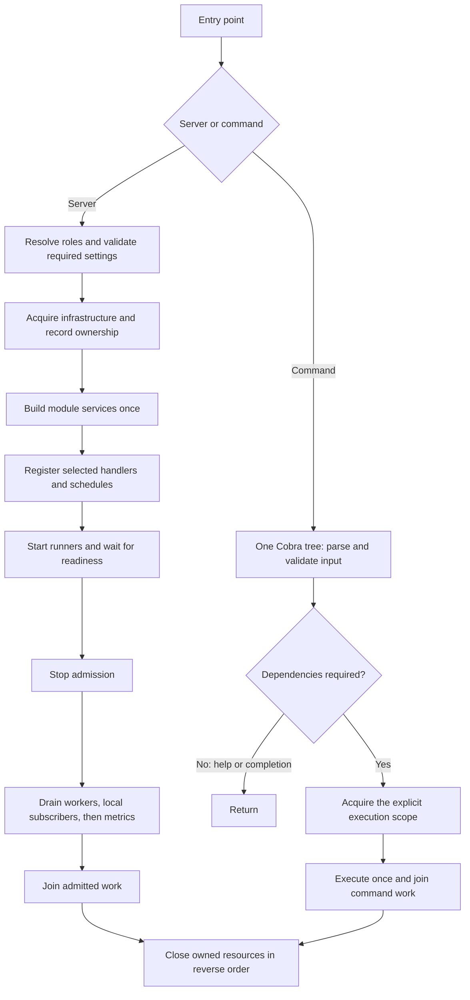

# App design review — 2026-10-06

> Historical design record. The current implementation uses eager application
> construction for every CLI invocation, shared `dependencies.Resources`, and
> module-owned command/SQL registration through `dependencies.Targets`. Offline
> help, lazy command callbacks and separate catalogs described below were replaced
> by the simpler design in [application lifecycle](../application-lifecycle.md).

Implementation follow-up: [refactor results](app-refactor-results.md). The findings
below record the pre-refactor state.

Status: focused review before implementation. This refines the approved
[framework reassessment](framework-reassessment.md). Runtime code was not changed.

The App package needs a substantive composition refactor. Its main cost is not
thirteen source files: it combines different lifetimes and repeats command assembly.
The deeper review also found two reproducible event shutdown defects. Fix those
before reorganizing the lifecycle code.

## Findings, ordered by consequence

### 1. An event handler can outlive successful application cleanup — P1

**Evidence:** [messagingRunner.Run](../../internal/platform/app/messaging.go) simply
returns `router.Run(ctx)`. [App.Close](../../internal/platform/app/app.go) checks
runner completion, not the individual event calls. In the pinned Watermill version,
router shutdown can time out while a handler remains active; `Run` still returns
nil. The close error is reported through Watermill's logger rather than returned
from `Run`. See the [upstream implementation](https://github.com/ThreeDotsLabs/watermill/blob/v1.5.3/message/router.go).

**Reproduction:** A handler signals entry and waits on a release channel. Cancel
the app with a short router close timeout. App `Run` and `Close` both return nil,
and an owned resource closes before the handler is released. This reproduced ten
times under the race detector. It is an ownership bug, not a detected data race.

**Change:** Make the messaging integration uphold the existing runner contract:
stop new calls, track admitted calls, and join them before its runner returns.
Account for native router shutdown errors explicitly. Cover startup failure after
partial subscription as well. Reuse the reasoning behind Asynq's existing handler
gate; do not invent a generic asynchronous subsystem to share a few lines.

**Benefit:** An event cannot continue using a database, logger or client after App
releases it. **Risk:** Waiting for uncooperative handlers is necessarily cooperative;
the app must report its deadline and keep dependencies alive while work remains.
It must never turn timeout into a successful close.

### 2. Removing all event handlers breaks graceful shutdown — P1

**Evidence:** The same adapter relies solely on context cancellation. With zero
handlers, the native router's watcher waits for a handler or explicit router close,
not cancellation. A router can signal readiness and then remain running indefinitely.

**Reproduction:** Run an empty router, wait for readiness, cancel the app. App
returns `ErrShutdownTimeout`; `Close` returns `ErrRunning`. Explicit router close
then allows it to finish. Reproduced ten times under the race detector.

**Change:** Own explicit router shutdown at the integration boundary and avoid
starting a local subscriber runner when no subscriptions are installed. Test both
the adapter itself and the application with its last subscriber removed.

**Benefit:** Removing an example module does not break process termination.
**Dependency:** Implement with finding 1 so native close and handler joining have
one owner. **Risk:** Closing a shared subscriber too early would interrupt active
publishers; preserve staged application drain.

### 3. The command path has two command trees and two execution paths — P1

**Evidence:** [consoleDefinition](../../internal/platform/app/cli.go) calls module
constructors with nil dependencies, recursively replaces their callbacks, creates
a complete App, then parses and executes the original arguments on another tree.
The generic CLI file imports all three business command packages. Module
`Register` functions maintain a second command catalog.

**Observed effects:**

- `identity show not-a-uuid`, with an unreachable database, reports database setup
  failure before checking the UUID. Argument count is checked by Cobra first, but
  input decoding inside the original `RunE` is delayed until after bootstrap.
- Outer output and error streams are forwarded; the input stream is not.
- A new module command registered only through the documented module `Register`
  path is absent from the outer CLI catalog. Existing command groups happen to be
  explicitly repeated there.
- Hook/flag/completion semantics must survive two different mutable trees. Current
  module commands have few hooks, so duplicate hook effects are a migration risk,
  not a reproduced defect in today's commands.

**Change:** One native Cobra tree, built without usable infrastructure. Commands
decode input and invoke explicit typed operation callbacks. App opens dependencies
when the selected callback needs them and owns cleanup around the entire invocation.
Do not recursively rewrite command callbacks, reparse arguments, or resolve
dependencies from context. Native command definitions stay in module CLI packages.

**Benefit:** One definition and one execution per command; invalid input fails
before infrastructure work. **Dependencies:** Establish typed module construction
results, described below. **Risks:** Streams, aliases, inherited flags and hooks,
completion, scheduled command factories, and cleanup after panic or cancellation.

### 4. Validation and acquisition happen at the wrong scope — P1

**Evidence:** [Execute](../../internal/platform/app/cli.go) loads and validates all
configuration before Cobra handles help. `QUEUE_REDIS_URL=invalid` prevents root
`--help`. The same coupling affects migration commands despite their DB-only
connection path. [openDependencies](../../internal/platform/app/bootstrap.go) opens
every configured subsystem and builds HTTP, task, event and console targets before
`Run` chooses which processes to start.

**Change:** Read one environment snapshot; decode and validate the settings used
by the selected operation before acquisition. Help must not decode unrelated
backend fields: merely removing `Validate` is insufficient because typed parsing
can itself fail. Keep validation strict for settings actually used. Select process
roles before constructing execution targets.

Start with offline help, database migrations, queue administration and the normal
application. Keep these explicit execution paths; do not introduce a capability
graph, universal `BootMode` annotations or automatic dependency inference.

**Benefit:** A broken optional integration cannot prevent unrelated administration.
**Risks:** An HTTP producer still needs its queue client even without local workers.
An Identity read command cannot honestly be called DB-only while its service
constructor requires an event publisher; reduce that coupling deliberately later,
without injecting fake no-op dependencies.

### 5. The resource and registration bundles hide different responsibilities — P2

**Evidence:** [Dependencies](../../internal/platform/dependencies/dependencies.go)
embeds `Registration`, so a single `a.deps` accesses a DB pool, native HTTP engine,
business route groups, console tree, registry targets and publishers. Only App
currently uses the full `Dependencies` type outside tests. Business services already
receive narrow arguments; that part of the boundary works.

**Change:** Retain the neutral package and remove embedding. Use separate App fields
for infrastructure and registration targets. Keep the HTTP engine, worker, scheduler
and router ownership with App. Registration borrows the relevant pointers during
startup; a borrowed alias is not a second owner. Business services never enter this
neutral bundle. Remove `Migrations` from module registration when the static App
catalog becomes its sole owner; no current module uses that field.

**Benefit:** Borrowing a target cannot accidentally grant access to infrastructure.
**Risk:** Public field access changes in examples/tests. Do this mechanically after
the lifecycle regressions, with no simultaneous behavior rewrite.

### 6. Module construction, authentication setup and registration are interleaved — P2

**Evidence:** [registerModules](../../internal/platform/app/modules.go) creates
repositories, builds six optional Identity operations, connects Media to
Notifications, chooses authentication, and registers three modules. Its name only
describes the final part. The transaction adapter also delays a missing dependency
error until the first Media operation.

**Change:** Use ordinary `buildIdentity`, `buildNotifications` and `buildMedia`
functions in App composition. Construct once, then create authenticated HTTP targets,
then register the selected transports. Keep the visible Media → Notifications call.
Use small typed results only where another phase genuinely needs them: Identity
already has a useful `identity.Services` value. A private App result can retain the
few service instances needed by CLI binding; it is not a runtime lookup registry.

**Benefit:** Readers can see the dependency order and feature decisions without
following transport registration. **Risks:** Typed nil interfaces, accidentally
constructing services twice, and changing the fail-closed authentication behavior.
Validate required infrastructure for the installed operations before construction.

### 7. Process roles and business services use overlapping names — P2

**Evidence:** `app.Services`, private `service`, `services`, `runServices`,
`identity.Services`, and module `service.Service` describe different things.
`Queues` actually selects workers; `Events` selects consumers. `APP_ROLES=workers`
implicitly adds subscribers, while HTTP requires subscribers explicitly. A separate
GoChannel subscriber process cannot consume another process's publications.

**Change:** Use `Roles` for process selection, `runner` for a blocking execution
contract, and `process` for a named runner plus shutdown phase. Use `Workers` for
the worker selection. Keep `service` for business operations. For the current
GoChannel transport, derive local subscribers from installed subscriptions and
local publishers rather than requiring users to understand a separate subscriber
deployment role. Keep scheduler enablement explicit.

**Benefit:** Configuration describes what operators run; service constructors
describe what the business does. **Risk:** Removing the `subscribers` role is an
intentional configuration change. Update deployment manifests, examples and tests
together; do not silently reinterpret old role selections. Do not rename public
business service types just to make every package look identical.

### 8. Entry points do not enforce the same startup requirements — P2

**Evidence:** Required application DB checks live in `Serve` and a command-name
check inside the outer CLI wrapper. Direct `New` → `Run` bypasses them. Existing
HTTP lifecycle tests construct the full installed module set without a database.
The default readiness signal therefore establishes runner startup, not usability
of every installed operation. `StartupTimeout` also applies separately to
construction and runner startup; it is not one total startup deadline.

**Change:** Centralize installed-operation requirements and resolve roles once.
All serving entry points use that same path. Keep route-only assembly available
for tests without presenting it as a successfully booted production app. Document
construction/startup/drain/cleanup budgets explicitly. Preserve optional continuous
readiness probes as a separate operational choice.

**Benefit:** Entry points have predictable guarantees. **Risk:** Tests currently
depend on permissive construction; replace their setup at the appropriate boundary
rather than weakening production validation.

### 9. Registration combines transports that do not share a lifetime — P2

**Evidence:** Media requires an event router even when only its CLI operation is
wanted; Notifications requires both events and task routes. HTTP and console targets
are optional in the same functions. Constructing all targets hides this asymmetry.

**Change:** Separate command definition registration from runtime handler registration
where their construction phases differ. For runtime targets, explicitly skip
unselected boundaries and validate every selected boundary's dependencies. Keep
ordinary functions and native routers. Do not introduce a module lifecycle object.
Schedules continue to use an explicit allowlist of fresh standalone command
factories; they must not execute the mutable interactive command tree.

**Benefit:** Worker-only construction need not create business HTTP routes or a
console; command execution need not configure workers. **Dependency:** Findings
3–6. **Risk:** Accidentally omitting a required handler; test each selected boundary.

### 10. Documentation describes a different bootstrap than the code — P2

**Evidence:** App README claims ten implementation files, says modules register
migrations, refers to a removed Orders seeder, and says the scheduler waits for
workers. Current code has thirteen files, a static migration catalog, and no such
scheduler readiness gate. The CLI guide's module-registration instructions omit
the outer command catalog.

**Change:** Update the affected App/module/CLI guides with each implementation slice.
Check an add/remove-module example through the real entry points. Avoid prose
assertions about exact file counts or safety that is only implied by interfaces.

**Benefit:** New users can follow documentation without learning hidden exceptions.
**Risk:** Updating only the central documentation leaves package READMEs stale.

## Responsibilities to keep distinct

| Concept | Owns | Does not own |
| --- | --- | --- |
| Entry point | Signals, exit status | Dependency assembly |
| App composition | Settings, connection ownership, business wiring | Business decisions |
| Infrastructure dependencies | Pools, clients, publishers, telemetry providers | Business services, registrations, process roles |
| Registration targets | Borrowed HTTP/task/event targets and explicit registries | Connection setup or cleanup |
| Business service | A module's operations and invariants | Starting runners or interpreting environment |
| Runner | Admission, active work and completion of one process | Closing borrowed DB/client dependencies |
| App supervisor | Readiness, cancellation order, joining runners | Knowing Identity/Media/Notifications operations |
| Console execution | One Cobra invocation and its required resource lifetime | Starting a full server for every command |

Keep these as responsibilities, not eight new exported types. The useful existing
abstractions are `runner`, narrow consumer interfaces, and owned cleanup functions.
Do not add `Container`, `Kernel`, `Provider`, a generic `Module`, or a service locator.
Do not move application-specific supervision to `pkg` merely to shrink App.

## Proposed file organization

```text
internal/platform/app/
  app.go             public lifecycle, ownership guards and cleanup
  bootstrap.go       explicit construction/validation sequence
  modules.go         module construction, cross-module wiring, command composition
  console.go         one Cobra execution path and framework command definitions
  migrations.go      resource-free sources and migration commands
  schedule.go        editable task/command timing
  infrastructure.go  DB, cache, storage, mail, rate limiting and telemetry setup
  http.go            Gin setup and HTTP/metrics runner construction
  queue.go           Asynq setup, middleware, inspector and dashboard
  messaging.go       GoChannel setup and correct handler lifetime adapter
  runtime.go         process selection, readiness and staged drain
```

This is eleven production files: merge the small mail/rate-limit setup files into
infrastructure, rename CLI to console, and keep the migration catalog separate.
Move migration commands beside that catalog instead of making console a catch-all.
Do not merge runtime into bootstrap or tests into giant files to reach a number.
Keep user-editable lists above private machinery.

Avoid adding a separate console-composition file on top of `modules.go`. Module
imports and explicit module-specific bindings belong in that one App composition
file; generic console execution must not carry a second module catalog.

## Concrete developer experience

Runtime composition remains ordinary Go. The following is a target sketch, not an
implemented API:

```go
identityServices, err := buildIdentity(cfg.Identity, infra)
if err != nil { return err }
inbox, err := buildNotifications(infra.DB, infra.Queue)
if err != nil { return err }
mediaService, err := buildMedia(infra.DB, infra.Transactions, inbox)
if err != nil { return err }

// Authentication is installed before modules borrow protected routes.
targets.AuthenticatedHTTP = authenticatedRoutes(targets.HTTP, identityServices.Sessions)

if err := identity.Register(targets, identityServices); err != nil { return err }
if err := notifications.Register(targets, inbox, subscriber); err != nil { return err }
return media.Register(targets, mediaService, subscriber)
```

`infra` is borrowed by App assembly only; each constructor still receives its narrow
dependencies. No business service receives the full bundle. The build functions
remain in App, as required by this repository's composition convention.

The existing typed Identity command callback is already a useful seam:

```go
// CLI definitions capture a real operation, not nil service placeholders.
identitycli.New(func(ctx context.Context, id uuid.UUID) (*entities.User, error) {
    application, err := invocation.application(ctx)
    if err != nil { return nil, err }
    return application.identity.Users.Get(ctx, id)
})
```

Here `invocation` is an App-private owner for one console execution, not a general
resolver. The sketch's first implementation can reuse full application construction
while eliminating the second tree. It closes any acquired App after Cobra returns,
including on panic. Later scopes reduce acquisition where actual service contracts
allow it. No lookup by name/type and no resolver enters a business service. Keep
the original Cobra command's streams and context; UUID parsing happens before this
callback. Adapt other commands to typed operations only where necessary.

Do not promise that every new module needs exactly one code edit. There are separate
facts to declare, and making them invisible would add more complexity:

| Work | Intended application touchpoints |
| --- | --- |
| Add a handler to an installed module | Owning module's transport registration |
| Add an HTTP-only module | `app/modules.go` |
| Add a persisted module | `app/modules.go` and `app/migrations.go` |
| Add commands to an installed group | Module command definitions; bind any new operation explicitly in `modules.go` |
| Add a recurring operation | Owning operation plus timing in `app/schedule.go` |
| Add genuinely new infrastructure | Its typed config and App setup/ownership |

`modules.go` may have separate, clearly named construction and command-binding
functions. A single physical file is not a claim of a single registration phase.
Eliminate repeated command metadata and feature decisions; preserve necessary
explicit dependency arguments.

## Lifecycle to preserve and make true



Retain startup rollback, readiness gating, group cancellation before group joining,
single-use App execution, idempotent cleanup, preservation of primary and cleanup
errors, and refusal to close dependencies still in use. The synchronization guards
serve real invariants; replacing booleans with a public state machine or wrapping
all fields in five new structs would not solve the identified problems.

GoChannel remains local and best-effort. This refactor does not establish durable
signup fanout, an outbox, or cross-process event delivery. Shared entities, enums
and event contracts remain in `internal/shared` under the accepted tradeoff.

## Implementation order and acceptance

1. **Repair messaging lifecycle, small focused change.** Turn both reproductions
   into durable regression tests. Verify partial startup failure, concurrent close,
   empty subscriptions, slow handlers and normal drain. Keep native Watermill APIs.
2. **Separate dependency storage and name the composition phases.** Remove embedding;
   split construction from registration with explicit typed results. No new runtime
   DI abstraction. Preserve existing endpoints, schedules and service identity.
3. **Replace the CLI path on a vertical slice.** Identity show, migrate, serve and
   nested help execute through one tree. Prove input validation before acquisition,
   streams, aliases, hooks, completion and all cleanup paths. Then migrate other
   command groups and the documentation in the same change.
4. **Resolve process roles before construction; narrow acquisition.** Remove the
   GoChannel subscriber deployment illusion. Unused boundaries create no routes or
   runners. DB migrations and queue administration use their actual dependencies.
   Preserve producer dependencies, authentication and readiness behavior deliberately.
5. **Consolidate files and verify the developer workflow.** Merge only cohesive
   setup, update names and examples together, and add/remove a small module through
   real entry points. Ordinary module changes must not require editing lifecycle
   machinery. An HTTP-only installed application must run without Redis or Postgres.

Steps 1–3 precede the broader reassessment's capability and release work. Step 4 is
the highest-risk architecture change: review actual constructor dependencies before
claiming a smaller resource scope. Each step needs its own behavior review rather
than merging everything into a single rewrite.

## Verification performed for this review

- Read production App code, callers, module registrations, relevant config,
  dependency contracts, runtime/CLI tests, package guides and pinned library code.
- Focused race tests passed for App, CLI, Config, Asynq adapters and middleware;
  focused vet passed. These checks do not cover every path.
- Both event lifecycle defects reproduced ten times with race detection using a
  temporary Go overlay outside the repository. Its tests asserted the observed
  defective behavior for diagnosis; they are not permanent passing correctness tests.
- Ran the real console entry point to reproduce invalid queue config blocking help
  and invalid UUID input triggering database initialization first.
- No external DB/Redis integration suite was run for this review. Existing external
  backend tests were skipped without their test URLs; no deployed services changed.
- No Go implementation, config, schema, dependency or business contract changed.
  Only this review and the reassessment priority note were added/updated.
