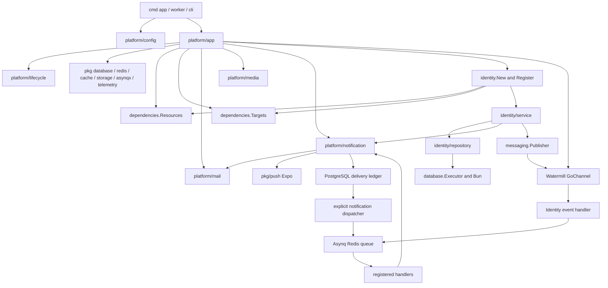

# Repository assessment and understanding report

Review date: 2026-10-11. Scope: the current working copy of `go-modular`, including existing uncommitted work. This is a factual baseline; proposed changes are in [03](03-platform-harmonization.md) and execution tasks in [07](07-refactoring-roadmap.md). No production changes were made for this review.

## Repository understanding gate

The repository is a **Go application template with reusable foundation packages**, not a separately published framework library. Its single Go module is `go-modular`, targeting Go 1.27.2. `internal/platform` deliberately cannot be imported by unrelated Go modules. That fits a clone-and-customize template; publishing an independently importable framework would be a different product decision.

The application already uses a small number of coherent patterns: explicit construction, borrowed dependencies, native transport registration, narrow service contracts, context-carried transactions, and centrally owned runtime resources. Most complexity in notification delivery, authentication, and shutdown protects real failure semantics. File count alone does not establish overengineering.

The strongest remaining concerns are inconsistent enforcement at boundaries, a few misplaced responsibilities, and documentation that sometimes contradicts the implemented conventions. The baseline below establishes this report's factual foundation before the target-design documents.

### Discovery and structure

There are 84 Go packages and 21 packages under `internal/platform`. The platform has 82 production Go files and 45 test files; its four-file `app` package has no colocated tests. Identity is the installed business module. There is no chat module, mobile application, broadcast service, or registered WebSocket endpoint.

| Area | Current responsibility and inspected material |
| --- | --- |
| `cmd/app`, `cmd/worker`, `cmd/cli` | Thin executable entrypoints; signal-aware application execution or console execution |
| `internal/platform` | App composition, API policy, CLI, configuration, resource/registration bundles, lifecycle, mail, media, notification, messaging, seeders, test fixtures |
| `internal/identity` | Passwordless account registration, OTP/social sign-in, verification, profile/session operations; nested transport directories, owner service/repository contracts |
| `internal/shared` | Business entities/enums, authentication principal and event contracts, domain values, shared migrations |
| `pkg` | Application-independent database/migration, Redis, cache, queue adapters, storage, mail rendering, push, logging, tracing, metrics, rate limiting, errors, pagination, OTP, token and hasher primitives |
| `examples` | Independently built mail, push, storage, cache, CLI and social-login examples; catalog module and transactional profile workflow |
| `tests` | External application, identity, module, platform and queue behavior; architecture rules. These compensate for deliberately absent app/service/repository test files |
| `deployments`, `Tiltfile` | Shared non-root Docker image, Compose, development Kubernetes, optional broker manifests, observability stack, config reference |
| `.github/workflows/verify.yml`, `scripts` | Fast checks, required PostgreSQL/Redis integration job, generated guide/API checks, vulnerability scan, release evidence tooling |
| `docs` | 51 published pages selected by `navigation.json`, Markdown sources, generated HTML/Markdown, API contract, historical plans and focused research |

Configuration profiles were reviewed without reproducing private credential values. The full example/development profile and Tilt enable implemented capabilities with Redis and MinIO; the quickstart intentionally disables optional capabilities. Code defaults, supplied profiles and effective process overrides are different layers, not necessarily contradictory settings.

### Current application lifecycle

1. `config.Load` builds one isolated environment snapshot: selected dotenv file first, process environment overrides it. Explicit `APP_ENV_FILE=''` disables dotenv. `FromEnvironment` is deterministic and validates without opening connections; `Defaults` decodes defaults without validation.
2. `app.newApplication` validates configuration, opens logging and creates `lifecycle.Runtime`. Construction failures close already acquired resources in reverse order; initialization panics are handled by the assembly boundary.
3. `openDependencies` opens telemetry, push, database/transactions, cache, named filesystems, queue clients, mail, rate limiting and messaging, then creates router/registration targets. Some constructors are lazy clients; construction is distinct from readiness.
4. `registerModules` installs the mail task handler, registers shared migrations, constructs one Notifier and Media Library, constructs Identity, binds its authenticator, and registers module/capability transports. Identity also supplies the session-coordinated push-subscription callback.
5. Assembly validates combined migrations and the command tree, then registers recurring schedules from `app/modules.go`.
6. `Serve` selects HTTP, workers, subscribers and scheduler roles. Local subscribers become ready before HTTP/worker producers. Workers also run notification dispatch. The metrics listener is a separate process when enabled. CLI help uses full construction by explicit project policy.
7. Readiness reflects startup completion and optionally dependency probes. It is not a proof of SMTP delivery, schema compatibility, notification backlog age or cloud health.
8. On shutdown, readiness closes; admission stops, workers drain, local subscribers drain, then metrics stop. Resources close in reverse acquisition order after their users finish. The runtime has bounded drain/cleanup budgets and does not close dependencies still in use by noncooperative work. Go cannot forcibly terminate a stuck goroutine.

Evidence: [app.go](../../internal/platform/app/app.go), [resources.go](../../internal/platform/app/resources.go), [modules.go](../../internal/platform/app/modules.go), [lifecycle.go](../../internal/platform/lifecycle/lifecycle.go), [load.go](../../internal/platform/config/load.go), [httpserver](../../pkg/httpserver/server.go).

Intentional exceptions matter: `cmd/worker` does not start cron scheduling; only one scheduler owner should publish a schedule set. HTTP-only and worker-only roles still construct configured dependencies. This is not a runtime service locator or lazy dependency graph.

### Complete platform inventory

Counts are production/test Go files, excluding SQL and READMEs. External tests are listed where relevant. “Borrowed” means the package must not close the injected resource.

| Package | Files | Purpose and public surface | Dependencies, configuration, lifecycle and consumers |
| --- | ---: | --- | --- |
| `api` | 6/4 | `NewRouter`, strict `DecodeJSON[Limit]`, native binder helpers, pagination, health routes | Gin/validator, response and middleware; HTTP policy from app; constructs no listener. Identity/media/notification HTTP consume it |
| `api/middleware` | 10/3 | Bearer authentication, principal helpers, error/recovery policy, body/cache/rate/telemetry middleware | Shared principal, logging/tracing/metrics/limiter; per-request context; installed by app and module delivery |
| `api/response` | 3/1 | `Envelope`, `Problem`, `OK`, `Created`, `Accepted`, `Error`, options | Gin/native status; pure response boundary. No process or config ownership |
| `app` | 4/0 | `Serve`, `Execute`, `Roles`, `OpenFilesystemConnection` | Config, lifecycle, all resources, Identity and capability integrations. Sole composition/resource owner; external tests in `tests/app` |
| `cli` | 3/3 | `New`, `Validate`, queue commands, zero-value `ScheduledCommands` | Cobra and native Asynq; borrowed registries/inspector. Fresh command tree per execution; app and examples consume it |
| `config` | 18/8 | `Load`, `FromEnvironment`, `Defaults`, typed capability configs and `Options` converters | env/dotenv plus owner settings types; no resource acquisition. App, Identity assembly and examples consume it |
| `dependencies` | 1/0 | `Resources`, `Targets` | Typed borrowed clients vs startup registries; no globals/lifecycle. App, module roots and capability integration only |
| `internal/reference` | 1/0 | `Valid(kind,id)` | Private platform syntax check for polymorphic references. Media and notification use it; no authorization/existence policy |
| `lifecycle` | 1/1 | `Runtime`, `Runner`, `Process`, `AfterReady`, `Own[Client]` | Context/slog, ready/stopping channels and time budgets. App consumes it; no business knowledge |
| `mail` | 4/0 | `Sender`, `Mailer`, `New`, `NewSMTP`, `Message`, `NewHandler`, tracing | Optional Asynq, go-mail SMTP; borrows clients, no autonomous worker. App, Identity, Notifier, examples; tests in `tests/platform`, `tests/queue` |
| `mail/integration` | 1/0 | `Register(sender,targets)` | Mail + Targets; installs mail task handler before workers. App only; keeps core free of dependency-bundle imports |
| `media` | 3/3 | `Library`, `New`, `Asset`, `Owner`, `Policy`, upload/get/list/open/delete/recover | Bun/PostgreSQL + named Go CDK buckets; copied disk map, borrowed buckets; no goroutines. App injects it; its integration consumes it |
| `media/integration` | 4/1 | `Register`, HTTP handler/contract, CLI and recovery task | Native Gin/Cobra/Asynq plus embedded migrations; default current-user authorization; app installs it |
| `media/migrations` | 1/0 | Embedded `Files` | PostgreSQL baseline SQL; registered explicitly by integration, never auto-applied |
| `messaging` | 4/2 | `Publisher`, JSON message helpers, Watermill logger, `RegisterRunner` | Native Watermill transport/router; borrows publisher, bridges readiness/drain. App and Identity use it |
| `messaging/middleware` | 2/0 | `TraceHandler`, `LogFailures`, `NewTracedPublisher` | Native Watermill + OpenTelemetry/logging; context propagation and bounded diagnostics. Installed in app; broader coverage in module/observability tests |
| `notification` | 6/6 | `Notifier`, `Message`, channel enum, recipient/record/delivery/subscription types, dispatch/deliver/read/push operations | PostgreSQL ledger; optional mail/views, queue, Expo sender and telemetry. Constructor starts no work; explicit dispatcher runner. App, Identity and profile example consume it |
| `notification/integration` | 5/1 | `Register`, database notification HTTP, subscription HTTP callback, CLI and tasks | Native targets + notification migrations. Identity supplies atomic session authorization callback; app registers it |
| `notification/migrations` | 1/0 | Embedded `Files` | PostgreSQL notification, delivery and subscription baseline schema; integration registers it |
| `seeders` | 1/1 | Zero-value `Registry`, `Register`, `Names`, `Run` | Named context functions, no DB ownership, no automatic execution. App/Targets expose it |
| `testdb` | 3/11 | `Open[Driver]`, `Migrations`, `Migrate`, `RateLimiter` | Testing, disposable configured DB/Redis and embedded test migration fixtures. Test-only consumers; no production imports |

The inventory does not imply each package needs its own public README or generic `Service` interface. Small helpers can be documented by their owning guide.

### Dependency and component interaction map

Arrows represent construction, dependency or execution relationships, not a promise that all shown relationships are Go imports. In particular `Resources` borrows capabilities; it does not construct them. Capability cores do not import integration packages or module assembly. Native registration targets are deliberately visible at delivery boundaries.

| Pinned dependency | Current boundary |
| --- | --- |
| Gin v1.12.0 / validator v10.30.3 | Native routing/binding at delivery; framework owns bounded JSON, envelopes, auth/error policy |
| Bun v1.2.18 / pgx v5.11.0 / Goose v3.28.0 | Native query power; framework owns pool lifecycle, transactions, ordered migration registry |
| Asynq v0.26.0 | Native tasks/options/mux/scheduler/inspector; `asynqx` adds routing, lifecycle and telemetry without inventing another job engine |
| Watermill v1.5.3 | Native router/subscriber; module services publish ordinary payloads through `messaging.Publisher`; installed GoChannel is process-local |
| Go CDK v0.46.0 and AWS/GCS/Azure SDKs | Foundation opens native buckets; Media owns SQL metadata and recovery. A configured driver does not certify a live provider |
| go-mail v0.8.1 / `pkg/mailview` | SMTP mechanics hidden behind `mail.Sender`; rendering stays a separate reusable operation |
| go-redis v9.22.0 / redis_rate v10.0.1 | Connection configuration, bounded cache and rate-limit policies; queue/cache/limiter data isolation checked in app config |
| Cobra v1.10.2 | Native commands/flags/streams; framework validates trees and allowlists scheduled invocations |
| OpenTelemetry v1.46.0 / Prometheus v1.24.1 / slog | Explicit providers and instrumentation, no mandatory global container |

Versions describe this working copy, not advice to upgrade. `go.mod` also includes provider and transitive dependencies; this review did not audit every transitive library's internals.

### Existing conventions and representative workflows

**Module growth.** `examples/module/catalog/module.go` is a 26-line module that needs only construction and registration. Identity grows the same pattern into nested `delivery/http`, `delivery/cli`, `delivery/events`, `delivery/jobs`, `events`, `jobs`, `mailviews`, `notifications`, `service`, `repository` and migrations. Empty directories are unnecessary.

**Service ownership.** `identity/service/service.go` holds owner interfaces such as `UserService`; `user.go` contains `userService` and its constructor. Topic files add methods to the same receiver for larger use cases. Repository interfaces are in `repository/repository.go`; concrete repositories and constructors remain beside their operations. Consumers reuse these contracts rather than duplicating them.

**OTP sign-in.** HTTP decoding → AuthService → rate budget and challenge proof → repository-owned authentication transaction → user/session/refresh records → commit → best-effort registration publication → token response. New accounts return 201, existing accounts 200. Authentication transactions deliberately reject enclosing transactions so failed-code attempts and replay revocation cannot be rolled back by a caller. Bearer authentication checks authoritative session/account state, not JWT claims alone. Default unlimited session/refresh lifetime does not remove short-lived access tokens or logout/replay revocation.

**Welcome reaction.** Registration publication → local Watermill handler → `identity.welcome.v1` Asynq task → reload current user → module notification content → Notifier SQL intent → dispatcher → channel delivery. GoChannel publication is not durable and cannot reach another process. Stable welcome occurrence keys and ledger uniqueness mitigate retries, but SMTP/Expo effects are not exactly-once.

**Atomic profile update.** `examples/module/profile/update.go` uses one `TxManager.Execute` callback for `UserService.UpdateProfile` and `Notifier.Enqueue`, sharing the same DB and callback context. Rollback removes both changes. The notification receipt is provisional until the outer transaction commits.

**Mail.** Module mailview builder → `mailview.Renderer.Render` → `mail.Message` → immediate `Send` or optional Redis `Enqueue` → `mail.send.v1` handler. Queueing rendered mail is intentionally different from committing SQL notification intent. OTP mail remains immediate.

**Media.** Authorized owner + bounded upload policy → pending SQL asset → streaming bucket write → ready metadata. Delete records intent before object removal. Recovery revisits interrupted work in bounded batches with a late-writer grace period. Callers own closing readers returned by `Open`.

**Administration.** Module registers native commands and fresh scheduled-command factories. App supplies recurring timing once, after registration. Migration execution and seeders are explicit operator operations, not startup side effects.

### Initial evidence-backed inconsistencies

These are observations, with design remedies deferred to the finding records in [03](03-platform-harmonization.md).

| ID | Observation | Evidence and confidence |
| --- | --- | --- |
| F01 | HTTP 5xx logging records raw error text while other infrastructure boundaries classify it | `api/middleware/errors.go:66`; isolated probe confirmed a private marker appeared in logs, not the HTTP response |
| F02 | Publisher and app queue client do not reject SQL transaction contexts; mail/media/external notification operations do | `messaging/publisher.go:41`, `app/resources.go:320`, `mail/mail.go:120`; source-confirmed enforcement gap, not an observed broken Identity transaction |
| F03 | SMTP reads attachments wholly before network cancellation and only closes attachments successfully added | `mail/smtp.go:201–262`; isolated canceled-context/failing-reader probe confirmed both behaviors; partial cleanup is currently documented |
| F04 | Notification dispatcher performs startup/hourly subscription pruning outside central recurring schedules | `notification/delivery.go:222–237`, `app/modules.go:75`, `docs/scheduling.md`; source-confirmed policy inconsistency |
| F05 | Config accepts a Redis cache namespace that the component constructor rejects | `config/cache.go:36`, `pkg/cache/redis/store.go:35`; no-I/O probe confirmed mismatch. SMTP validation also has two owners |
| F06 | Per-attempt event tracing labels a failure `retry_budget_exhausted=true` before a successful retry | `messaging/middleware/middleware.go:126`, retry ordering in `app/resources.go:487–517`; isolated retry-then-success probe confirmed it |
| F07 | The named-storage example imports app composition to open a bucket | `app/resources.go:158`, `examples/storage/main.go`; import graph confirms avoidable coupling to application assembly |
| F08 | Notification SQL resides both in a private store and orchestration/subscription methods | `notification/store.go`, `delivery.go:242`, `subscriptions.go:56`; maintainability concern, not a demonstrated correctness failure |
| F09 | An assembly guide writes `Resources.Notifications`, but the actual field is `Notifier` | `docs/module-registration.md:23`, `dependencies/dependencies.go:49`; concrete invalid fragment despite green doc build. Transaction guide also suggests redeclaring an existing execution contract |
| F10 | Inherited workspace guidance describes older registration/model/offline-help patterns | `/Users/barakat/workspace/AGENTS.md` versus `docs/conventions.md`, actual tree and explicit user decisions; governance/documentation conflict, not runtime behavior |

### Verification baseline

All results below were obtained during this review unless explicitly identified as prior evidence.

| Check | Result | Scope and limits |
| --- | --- | --- |
| `APP_ENV_FILE='' go test -race -count=1 -json ./...` | Pass | 84 packages: 52 package passes, 32 with no test files; 647 test/subtest pass events and 84 skip events. Nested test events are not a coverage percentage |
| Required `scripts/verify-integration.sh` | Pass | Separate disposable PostgreSQL 17 and Redis 7; all four required test URLs configured; full race suite. Optional MySQL/Redis Cluster/S3 suites not enabled |
| `go vet ./...` | Pass | Static checks with repository toolchain |
| `go build ./cmd/... ./examples/...` | Pass | All executable/example packages compile |
| `gofmt -l` over Go sources | Empty | No formatting drift detected |
| `go test -race -count=1 docs/build.go docs/highlight_test.go` | Pass | Builder/highlighter tests |
| `go run docs/build.go` | Pass | 51 published pages; existing file contents remained identical |
| `go generate ./internal/platform/api` in isolated copy | Pass, byte-identical spec | No source-tree API artifact changes |
| `govulncheck@v1.8.0 ./...` | No reachable findings | Zero affected imported packages; four module-only advisories. Dated scan, not permanent safety proof |
| Four review-only probes in isolated copy | Observations reproduced | HTTP logging, SMTP failure cleanup/cancellation, config mismatch, retry telemetry. These deliberately assert baseline behavior, not desired regressions |
| Content-preservation check | Pass at understanding gate | SHA-256 of all 608 preexisting tracked/untracked nonignored files unchanged |

Private local evidence is under `/Users/barakat/.codex/outputs/go-modular-platform-review-2026-10-11/`: baseline logs, package inventory, pre-review manifest, required-integration result and `review-probes.log`. Disposable test services were removed. No messages were sent to live SMTP/Expo/Google services.

The repository already records release-image, Kubernetes termination, outage and restore exercises in `docs/release-readiness.md`. Those records were read, but those exercises were **not rerun for this review**. The current CI includes Docker-image and vulnerability checks; a described CI job is not evidence of a fresh remote CI run.

### Inspection limitations and unresolved questions

- Every platform package's production implementation/API, its configuration/lifecycle and consumers were inspected. Test inventories and representative behavior/failure tests were inspected; all enabled tests were executed. This is not a line-by-line formal proof of every test, generated asset or third-party implementation.
- Repository-wide discovery covered source, examples, docs, scripts, configuration, deployment and build files. Generated documentation was checked through its source/navigation/build; historical plans were treated as historical evidence, not specifications to reapply. No claim is made that every historical paragraph is still authoritative.
- Live providers, optional database/storage backends, device push presentation, real load, queue saturation and sustained-load shutdown were not exercised. Core integrations passing does not certify those environments.
- The existing dirty working copy is the review subject, not a clean release revision. Source hashes identify it locally; there is no new tag/commit or publication.
- Public module path, supported-version policy and private security-reporting destination remain release-owner choices already recorded in release readiness. A generic durable event outbox or realtime platform has no approved new requirement here.

**Understanding gate complete:** the target blueprint builds on this observed architecture and explicitly preserves its sound conventions. Scores and proposals in later documents are judgments and acceptance targets, not additional claims about verified runtime behavior.
