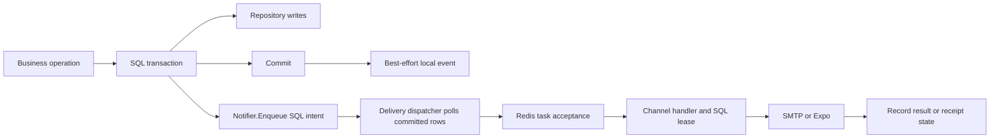

# Target architecture

Status: proposed; no package moves or runtime changes have been applied. Read [01](01-repository-assessment.md) for current behavior and [02](02-framework-design-philosophy.md) for the design contract.

## Structural decision

Keep the existing package graph. Harmonization here means better boundaries and fewer conflicting rules, not rebuilding the framework under a new folder vocabulary. **No platform package is proposed for removal, relocation, renaming or merger.** The useful consolidation is of validation rules, notification persistence ownership and documentation authority inside existing packages.

```text
internal/
  platform/
    app/                    # retain app.go, resources.go, modules.go, console.go
    config/                 # sole environment schema; pure conversions/validation
    dependencies/           # Resources + Targets only
    lifecycle/              # process readiness, draining and acquired-resource cleanup
    api/
      middleware/           # HTTP-only policies, safe failure reporting
      response/             # envelope helpers, native Gin retained
    cli/                    # native Cobra and bounded scheduled command adapter
    messaging/
      middleware/           # Watermill adapters, event tracing and final failures
    mail/
      integration/          # optional app registration of mail.send.v1
    media/
      integration/          # HTTP/CLI/recovery task registration
      migrations/           # embedded platform-owned schema
    notification/
      integration/          # HTTP/CLI/delivery and proposed pruning task
      migrations/           # embedded ledger/read-state/subscription schema
    seeders/                # zero-value explicit registry
    testdb/                 # test-only fixtures; keep import restriction
    internal/reference/     # private shared reference syntax, no generic entity API
  identity/
    module.go               # construct and register everything Identity owns
    service/
      service.go            # UserService/AuthService contracts
      user.go               # private userService + NewUserService
      auth.go               # private authService + NewAuthService and options
      session.go            # methods on authService
      verification.go       # methods on authService
      social.go             # methods on authService
      input.go              # operation input values
    repository/
      repository.go         # owner repository interfaces
      user.go               # private implementation + constructor
      session.go
      verification.go
      social.go
      transaction.go        # authentication's intentional commit policy
    delivery/{http,cli,events,jobs}/
    domain/
    integrations/
    events/
    jobs/
    mailviews/
    notifications/
    migrations/
  shared/{entities,enums,contracts,domain,migrations}/
pkg/                        # retain existing foundation capabilities
examples/                   # executable source for documentation
  module/{catalog,profile}/
tests/{app,identity,modules,platform,queue,architecture}/
```

The tree describes current directories plus their target responsibilities. It is not an instruction to create empty module directories or split every type into another file.

## Exact boundary changes

| Change | Current location | Target location / API | Why this is sufficient |
| --- | --- | --- | --- |
| Named disk selection | `app.OpenFilesystemConnection(ctx, wholeConfig, name)` | Proposed `FilesystemConfig.Options(name) (storage.Config,error)` in existing `config/filesystems.go`; caller uses `storage.Open` | Moves pure selection out of app; one native acquisition/cleanup pattern; no new filesystem manager |
| Cache validation | Part in app config, remaining rules only in driver constructors | Driver-owned pure default/validation helpers, reused by constructors and `CacheConfig.Validate` | Standalone and app users get the same rule; no generic config framework |
| SMTP validation and attachment bounds | `config/mail.go` duplicates checks; SMTP holds partial checks and unbounded reads | `SMTPConfig.Validate` plus shared normalized values inside existing mail files; optional aggregate `MaxAttachmentBytes` | Reuses owner settings without reintroducing `pkg/mail` |
| External-effect transaction check | Mail/media/notification only | Framework Publisher plus optional Asynq client middleware, installed by app | Reuses `database.RequireNoTransaction`; native escape hatch remains explicit |
| Subscription maintenance timing | Timer in notification dispatcher | Central task schedule in app; one handler in existing notification integration task file | Dispatcher remains responsible for delivery polling, not retention policy |
| Notification SQL | Store plus orchestration/subscription methods | Private `store` receiver helpers in existing notification files; orchestrators call them | Same package, no exported repository/service hierarchy, no new files required |
| Error reporting | HTTP raw error; attempt handler claims final failure | Existing HTTP and event middleware | Fixes policy in place, preserving public method signatures |

All other platform packages retain their existing structure and public APIs. File reduction is not an acceptance target; adding a one-purpose guard to an existing middleware file is preferable to deleting useful ownership boundaries.

## Composition and registration

The target preserves this sequence:

```text
Config.Load / FromEnvironment
  -> validate selected owner configs and app cross-component constraints
  -> open logging and lifecycle
  -> acquire resources; register each close immediately
  -> build native registries
  -> construct shared mail/notifier/media capabilities
  -> construct Identity and other business modules once
  -> install authentication and register each module/capability once
  -> validate combined migration and command definitions
  -> register central schedules
  -> start selected runners in dependency order
  -> expose readiness
  -> stop admission, drain, join, close in reverse order
```

Do not turn `Resources` into a registry that services query by strings. Do not add a `Module` interface merely to iterate over one business module. Different constructors can express genuine dependencies and errors; direct calls remain readable.

Adding a basic new module needs one module file and one app installation block. Adding persistence introduces its entity/repository/service/migrations inside the appropriate existing ownership boundaries. Its module registers its migration FS. Adding recurring timing requires one additional edit to the central schedule list; that exception is explicit and intentional.

### Resource ownership map

| Owner | Owns | Borrowers | Release rule |
| --- | --- | --- | --- |
| App/runtime | DB connections, Redis clients, buckets, queue client/inspector, local transport, telemetry/logging resources | Modules and capabilities | Close after all runners using them finish; reverse acquisition order |
| Native worker/router/scheduler adapters | Their executing goroutines and stop signals | Runtime supervises | Return only after admitted work is joined or report bounded shutdown failure |
| Module | Constructed service/repository/handler values | Its transports | No Close methods unless it actually acquires a resource; current Identity owns no goroutines |
| Mailer/Notifier/Library | Validation and operation policy, not borrowed client lifetime | Business services/handlers | Constructor starts no workers; use supplied context |
| Operation caller | Returned blob reader, explicit file readers | Current call only | Close on all paths; optional SMTP ownership transfer is specified in F03 |

## Execution boundaries that remain distinct



A transaction guard closes accidental call paths; it does not join Redis to SQL. GoChannel remains process-local. A notification polling loop remains appropriate because it is the progress mechanism for the ledger, independent of the cron scheduler. The new hourly subscription-pruning task requires a scheduler owner or an explicit operator invocation; delivery polling must still run without cron.

No realtime implementation is proposed. A browser or mobile application can read stored notifications through the existing authorized HTTP API; Expo handles external push delivery. Those are not a broadcast transport. If a future product requires broadcast, first define authentication, fanout, reconnection, retention and client guarantees in a separate decision. Do not reintroduce removed chat infrastructure as part of harmonization.

## Native library exposure and independent use

Keep Gin in delivery code, Bun in repositories, Cobra in command factories, Asynq in job definitions/options and Watermill in event registration. Framework policy should make the common path safe without copying each native API into another interface.

Independent use means construction without app bootstrap, plus explicit ownership:

- `mail.New(sender, nil)` for immediate-only mail; optional queue/handler/worker when needed.
- `notification.New(db, options)` with only channels required; PostgreSQL for persisted intent/read state; queue/dispatcher only for background delivery.
- `media.New(db, disks, defaultDisk)` with a caller-owned DB and buckets; optional framework HTTP/CLI integration.
- `messaging.NewPublisher(nativePublisher)` with caller-owned transport and optional framework runner.
- `cli.New` with commands and no application; scheduling is separately installed.
- `seeders.Registry` with explicitly registered operations; caller decides whether they use SQL.

The word “independent” does not promise external importability of Go `internal` packages. A future standalone framework distribution would require a separate compatibility and module-layout decision, not moving a few folders opportunistically.

## Compatibility and operational consequences

1. Moving the exported storage helper affects one production example plus docs and any downstream template forks. Replace calls with `cfg.Filesystem.Options(name)` followed by `storage.Open`; callers still close the returned connection. Remove the old helper only after in-repository migration. No alias is required for an unreleased template.
2. Transaction guards reject previously accepted unsafe calls. Audit all publisher/enqueue call sites; do not automatically move every call into an after-commit callback, which would still lack durability. Choose best-effort post-commit work or notification intent deliberately.
3. SMTP bounds can reject previously unbounded attachments; a proposed 20 MiB aggregate raw-attachment default is adjustable through typed config. This is a framework memory bound, not a guarantee that a provider accepts the encoded message. Explicit closing semantics must be documented before changing callers.
4. Central pruning changes process ownership: workers alone no longer perform recurring retention cleanup. Deploy the new handler to consumers before enabling its central schedule; allow mixed versions only during that order. Existing delivery task formats do not change.
5. Internal persistence extraction must preserve SQL, lock order, lease/status transitions, subscription versions, retries and idempotency constraints byte-for-byte initially. No schema change or payload rewrite belongs in that task.
6. Default feature enablement, private credentials, module folder nesting, eager CLI help and unlimited-session defaults remain as approved. None of these changes is required to address the findings.
